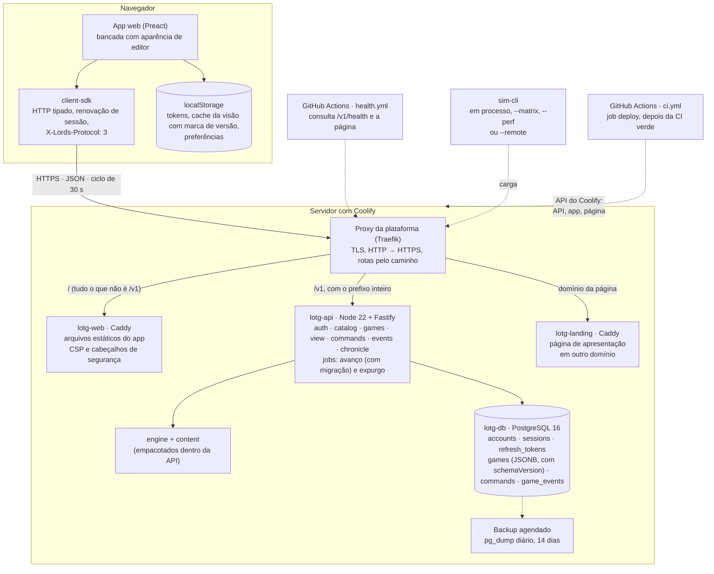
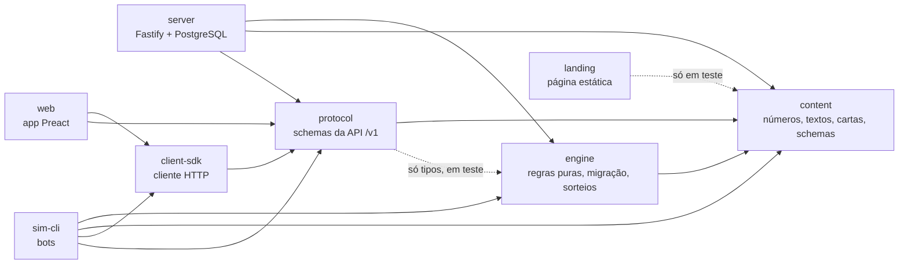

# Arquitetura da v0.3

O que está construído em Lords of the Guild depois da v0.3 "A Guilda", como as peças se encaixam e onde a implementação se afasta do [Game Design Document](../GAME_DESIGN.md). O GDD §14 continua sendo o contrato; este documento descreve o estado real em **2026-10-15** e aponta para o código. Ele foi reescrito nessa data como retrato da v0.3, e não anotado por cima do retrato da v0.2 (tarefa V3G-T4.3 do [roadmap da v0.3](roadmap-v0.3.md)): as versões anteriores estão no histórico do Git.

**Estado em 2026-10-15.** A v0.3 está implementada no `main` **local**, com o **estado do jogo na versão 24** e o **protocolo 3**, e **não foi publicada**: a produção roda a v0.2.0 (estado 12, protocolo 2) até o autor dar o `push`, e a publicação salta de uma vez as Fases B a F ([deploy/README.md](../deploy/README.md), "A primeira publicação da v0.3"). O lote 2 do Conselho (V3F-T1) ficou **fora** da v0.3.0 (pendência F-3). As regras novas são as dos ADRs [0017](decisions/0017-regras-da-v0.3-herois-taverna-e-soldo.md) e [0018](decisions/0018-expedicoes-mercado-mestres-e-cartas-na-v0.3.md), com as respostas do autor de 2026-10-06 e 2026-10-07 registradas neles. **Nenhuma pessoa jogou a v0.3**, e o conteúdo novo (heróis, candidatos, os dezoito grafos de expedição, frases do relatório, do Mercado, das caravanas e dos Mestres) é rascunho que o autor não leu. Antes de afirmar o que está no ar, confira `protocol` e `builtAt` em `GET /v1/version`.

Para o detalhe de cada pacote: [motor](../packages/engine/README.md), [servidor](../packages/server/README.md), [app web](../packages/web/README.md), [simulador](../packages/sim-cli/README.md), [página de apresentação](../packages/landing/README.md) e [implantação](../deploy/README.md). As medições estão em [balance-v0.3.md](balance-v0.3.md); as dúvidas e decisões do agente, em [pendencias-v0.3.md](pendencias-v0.3.md); o conteúdo em rascunho, em [content-v0.3.md](content-v0.3.md).

## 1. Visão geral

O diagrama do GDD §14.1, atualizado para a instalação que está no ar em `https://lords.palsincomehub.com`.



A instalação é a da v0.1 ([ADR 0009](decisions/0009-implantacao-no-coolify.md)): três recursos no Coolify mais a página de apresentação, a borda no proxy da plataforma, app e API na mesma origem, deploy automático a cada `push` no `main`. Nem a v0.2 nem a v0.3 criaram tabela, rota de infraestrutura nem recurso novo: tudo o que acrescentaram ao jogo vive dentro de `games.state` e de `game_events`. As rotas novas da v0.2 foram `GET /v1/catalog` e os campos novos de `POST /games`; **a v0.3 não acrescentou rota nenhuma**, só comandos, eventos e campos da visão, e `GET /chronicle.md` ganhou o parâmetro `links`.

Os princípios do GDD §14.1 valem como estão: o servidor é autoritativo e é o relógio; o motor é um só (servidor, simulador e testes); estado inicial, semente e log de comandos refazem uma partida que nasceu na versão atual (a de uma partida migrada tem um limite, ver 4.4); o avanço é preguiçoso, então uma queda do servidor não perde nada.

## 2. Pacotes e direção das dependências



A seta aponta para o que é importado. As regras, impostas por `no-restricted-imports` em [`eslint.config.js`](../eslint.config.js):

- `engine`, `content` e `protocol` não importam `fastify`, `pg`, Drizzle nem módulos do Node. Arquivos de teste ficam fora da regra.
- `server` e `web` nunca importam um ao outro.
- `web` não importa o motor nem, fora dos testes, `@lotg/content` e o `contentHash` de `@lotg/protocol` (que lê o catálogo inteiro). `packages/web/src/bundle.test.ts` compila o app e confere que nenhum número, frase, flag ou efeito escondido do conteúdo chega ao navegador: do conteúdo só entram as listas de identificadores que os schemas do protocolo usam.
- `landing` não importa pacote nenhum do jogo. Só os testes dela leem `content`, para conferir as frases da Crônica que a página cita.
- `protocol` depende do motor apenas como dependência de desenvolvimento: um teste de igualdade de tipos faz o `pnpm typecheck` quebrar se `Command`, `ViewState` ou os códigos de recusa divergirem entre os dois.

Os pacotes são consumidos como fonte TypeScript (`exports` aponta para `src/index.ts`). Só o que é implantado tem build: o servidor (um único `dist/main.js`, com esbuild), o app (`packages/web/dist`, com Vite) e a página de apresentação (`packages/landing/dist`, com Vite).

## 3. Onde fica cada responsabilidade

**O servidor orquestra, o motor decide, o app exibe.**

| Responsabilidade | Onde fica |
|---|---|
| Regras de jogo: produção, estações, estoque, obras e filas, ofício, moral, Conselho, Ameaça, incursões, objetivos, heróis, soldo, Taverna, expedições, Mercado, caravanas, Mestres | `packages/engine` (`advanceTo`, `applyCommand`) |
| Números, textos, cartas e frases da Crônica | `packages/content` (`balance.ts`, `buildings.ts`, `cards/`, `chronicle.ts`, `objectives.ts`, `tiles.ts`) |
| Leitura de um estado gravado em qualquer versão | `migrateState`, em `packages/engine/src/migrations.ts` |
| Sorteios | `packages/engine/src/random.ts`, só dentro de `advanceTo` |
| O que a interface mostra, com a explicação de cada número e a névoa da Ameaça | `deriveViewState` e os `*View.ts` do motor |
| Forma dos comandos, das respostas e dos erros da API | `packages/protocol` (zod) |
| Faixas e regras de um comando (recusa com frase em português) | Motor; o servidor responde `422 GAME_RULE` |
| Relógio, autenticação, propriedade da partida, lock, migração gravada, persistência, recibos | `packages/server` |
| Opções de nova partida e conferência do ritmo pedido | Servidor (`src/catalog.ts`, `GET /v1/catalog`) |
| Recusa de um cliente de outro protocolo (`426`) | Servidor (`src/plugins/errors.ts`) |
| Conversão entre tempo real e tempo de jogo | Servidor (`gameTimeAt`, em `games/repository.ts`) e `deriveViewState` |
| Filtro de apresentação da Crônica (sem viradas de dia nem fecho do desperdício) e a nota "Sua escolha voltou" no Markdown | Servidor (`chronicleRows`, `games/chronicleMarkdown.ts`) |
| Avanço de partidas paradas (migrando-as) e expurgo de contas excluídas | Jobs do servidor, sob advisory lock (uma réplica por rodada) |
| Renovação de sessão, retentativas de rede, mesmo `commandId` no reenvio, cabeçalho do protocolo | `packages/client-sdk` |
| Estado da interface, ciclo de atualização, cache com marca de versão, avisos, diálogos | `packages/web` (`app/controller.ts`, `game/gameSession.ts`) |
| Relatório de Retorno em três blocos e "Antes de partir", montados só com a visão e os eventos (com a Guilda, o Mercado, as caravanas e os Mestres) | `packages/web/src/game/returnReport.ts` e `beforeLeaving.ts` |
| A conferência de duas etapas do Mercado e das caravanas, e a única conta de regra do app (`quantidade × preço de hoje`) | `packages/web/src/ui/market.ts`, amarrada ao motor por teste |
| Credenciais e cache no navegador, sincronização entre abas | `packages/web/src/services` (`localStorage`, Web Locks, evento `storage`) |
| Balanceamento: bots que jogam só com a visão, matriz e faixas | `packages/sim-cli` |
| TLS, redirecionamento, rotas por caminho | Proxy do Coolify |
| Cabeçalhos de segurança do app (CSP, `nosniff`, HSTS) | Caddy da imagem `web` |
| Apresentação do jogo a quem ainda não joga | `packages/landing`, servida pelo Caddy da imagem `landing`, em outro domínio |
| Backup do banco | Agendamento do Coolify |
| Implantação a cada `push` no `main` | Job `deploy` de `.github/workflows/ci.yml`, pela API do Coolify |

O app não faz conta sobre o jogo. Quando a interface precisou de um número ou de uma frase que não estava no `ViewState`, ela foi acrescentada no motor: na v0.2 e na v0.3, por exemplo, `winter` e `calendar.nextSeason.firewood` (a conta da lenha), `resources[].fullInSeconds`, `constructions.planned[].waiting`, `perNewWorkerPerHour`, `morale.next`, `council.pending[].defaultOptionId`, `threat.incoming.defenseText` e `objectives[].missing`; na v0.3, `eligibleHeroIds`, `canSend`, `suggestedTeam` e `sendBlockedReason` (quem pode partir em uma expedição), `canDismiss`, `wageNextLevelText` e o excedente vendável do Mercado (`surplusSellable`, `surplusText`). Há uma exceção registrada: `previewAllocation`, no app, repete a ordem de saída das levas em adaptação só para a prévia antes de confirmar uma alocação (pendência C-15); um teste em navegador a compara com o servidor.


## 4. O estado e as versões

### 4.1 Um JSON inteiro por partida

O `GameState` inteiro fica em `games.state` (JSONB), sempre escrito por completo, nunca em pedaços. Da v0.1 para a v0.3 o estado cresceu de 1 para 24 versões sem uma migração de SQL sequer: mudar a forma do estado não muda o esquema do banco. A coluna `games.schema_version` é só um espelho para consultas (`select schema_version, status, count(*) from games group by 1, 2`).

Quatro coisas têm versão, cada uma com o seu tratamento ([README do servidor](../packages/server/README.md), "O que tem versão"):

| O quê | Número | Quando muda |
|---|---|---|
| Estado da partida | `state.schemaVersion` (hoje 24) | Uma tarefa muda a forma do `GameState`: um passo de migração por versão |
| Conteúdo | `contentHash` em `GET /version` e `GET /catalog` | Qualquer número, texto ou carta de `@lotg/content`; o conteúdo vai na imagem e não é gravado no banco. **Exceção:** os ids de carta, de modelo de expedição, de nó, de opção, de candidato, de item e de Mestre, e os limites do Mercado e das caravanas, ficam gravados no estado e pedem passo de migração para mudar |
| Protocolo | `protocol` em `GET /version` (hoje 3); o cliente manda `X-Lords-Protocol` | Uma mudança que o app antigo não consegue ler (ver seção 10) |
| Recibos de comando | Nenhum | Nunca são reescritos: o reenvio devolve a resposta da época, byte a byte |

### 4.2 `migrateState`

Um estado gravado só entra no motor por `migrateState(stored, { timeScale })`. Ela é pura, sequencial (1 → 2 → … → 24), idempotente e **confere a forma exata** de cada versão antes de mexer, também quando o estado já diz ser da versão atual: o número não é salvo-conduto. O que ela não conhece é recusado com `StateMigrationError` (`future` para uma versão mais nova que a do motor; `invalid` para uma forma inesperada), com o caminho do campo e o tipo, nunca o valor. Cada passo mora em `packages/engine/src/migrations/`, com a forma exata da versão de que parte, os identificadores escritos no arquivo (nada importado de `@lotg/content`) e um retrato congelado em `__fixtures__/`.

| Versão | Tarefa | O que entrou |
|---|---|---|
| 2 | V2B-T1 | `settings.difficulty` e `settings.timeScale`; `migratedAtMs` |
| 3 | V2C-T1 | O frio (`settlement.cold`) |
| 4 | V2C-T2 | Celeiro e Armazém em `buildings`; desperdício por relatar |
| 5 | V2C-T5 | Duas posições de fila; `autoStart` nas planejadas |
| 6 | V2C-T3 | Coortes de adaptação, experiência e mestria do ofício |
| 7 | V2C-T4 | Moral e efeitos temporários de moral |
| 8 | V2D-T1 | O Conselho (`council`) |
| 9 | V2E-T1 | Torre de Vigia; `map` (tiles e Ameaça); `horde` |
| 10 | V2E-T2 | A Paliçada em `buildings` |
| 11 | V2E-T3 | Os feridos (`settlement.injured`) e a incursão do roteiro marcada |
| 12 | V2G | As respostas do autor à v0.2 ([ADR 0016](decisions/0016-respostas-do-autor-as-pendencias-da-v0.2.md)); é o estado da `v0.2.0` e da produção |
| 13 | V3B-T1 | `state.ids` (contadores de identidade) e os fluxos de sorteio por entidade |
| 14 | V3C-T1 | `state.guild`: heróis, soldo e atraso |
| 15 | V3C-T3 | A carta roteirizada e a lista dos heróis prometidos (`guild.arriving`) |
| 16 | V3C-T2 | A Taverna: `buildings.tavern`, `guild.tavernOffers`, `guild.tavern`, o fluxo `tavern` |
| 17 | V3D-T1 | A Guilda dos Aventureiros, `guild.expeditions`, `guild.reports`, o herói em expedição |
| 18 | V3D-T2 | Os desfechos: ferimento, cativeiro, equipamento, `guild.inventory`, `map.discovered` |
| 19 | V3D-T3 | `standout` e `lesson` em cada registro do percurso |
| 20 | V3D-T5 | `freedAtMs` no herói; a lição do tipo `level` |
| 21 | V3E-T1 | O Mercado: `buildings.market` e `state.market` |
| 22 | V3E-T2 | As caravanas (`market.caravans`) e o herói em escolta |
| 23 | V3E-T3 | Os Mestres: `settlement.masters`, `settlement.mastersWaiting` |
| 24 | V3E-T5 | `worked` em cada Mestre (a primeira alocação é imediata) e a guarda dos limites do Mercado e das caravanas (`marketLimitsWithinState`) |

Os objetivos 5 a 10 (V2E-T4) e os 11 a 16 (V3F-T2) **não mudaram a forma**: uma partida gravada antes deles fica fora do repouso e é acomodada na fronteira, antes de o tempo andar (seção 6). O contador novo dos objetivos (`expeditionsReturned:<modelo>`) não é preenchido por passo nenhum (pendência F-5; seção 21).

### 4.3 A fronteira

`migratedAtMs` é o instante de jogo em que a **última** migração encontrou a partida, isto é, até onde uma versão anterior das regras a simulou ([ADR 0013](decisions/0013-regras-da-v0.2-tempo-ritmo-migracao-e-economia.md), decisão 4). Como o conteúdo chega à produção em mais de uma publicação, **a fronteira é de cada passo**: `migrateWith` entrega a cada passo o `lastProcessedAt` da partida naquele momento (`context.boundaryMs`), e todo prazo que um passo cria conta dali. Nada da ausência anterior é recalculado com uma regra que não existia; o estoque acima do novo limite fica; um passo não emite eventos (quem abre o frio de uma partida parada no inverno é o primeiro `advanceTo`, na fronteira). Na v0.3 nenhum passo cria prazo, evento, identificador ou sorteio.

### 4.4 No servidor

`loadGame` (`packages/server/src/games/repository.ts`) chama `migrateState` sob o lock da partida, em toda leitura, todo comando e no job de avanço; o resto do servidor só enxerga o estado na versão atual. A migração é gravada pela primeira escrita daquela transação, com um único incremento de `state_version`. Duas requisições simultâneas migram uma vez. `persistState` confere também o estado que vai gravar (`assertStorable`). Um estado ilegível termina em `500` **sem nada gravado por cima**; o job conta a falha, registra a causa da primeira e segue com as outras partidas.

**Limite conhecido.** O instante de cada migração depende de quando a partida foi gravada pela última vez antes da publicação, e isso não se deduz da semente nem dos comandos. Refazer por replay uma partida migrada exige o estado gravado em cada fronteira (um backup); o estado guarda só a mais recente (pendência B-4). **A migração 12 → 24 nunca passou por uma partida de produção**: só pelos retratos congelados e pelos testes de integração.

## 5. Sorteios

O motor sorteia com um gerador próprio, com semente, em `packages/engine/src/random.ts`: xoshiro128\*\*, só com operações inteiras, e **fluxos nomeados**, cada um com o próprio estado em `state.rng[nome]`:

| Fluxo | Quem sorteia | Desde |
|---|---|---|
| `morale` | A chegada de um colono e a partida de um aldeão, na virada do dia | V2C-T4 |
| `council` | A carta de cada audiência | V2D-T1 |
| `horde` | A incursão que a Ameaça marca | V2E-T3 |
| `tavern` | A rotação dos candidatos (`tavernTurn.ts`) | V3C-T2 |
| `market` | O passo do preço de cada recurso na virada do dia; nasce na primeira virada com o Mercado de pé | V3E-T1 |
| `expedition:<id>` | O nó de uma expedição: a sorte, quem sofre, a cobiça, o saque, o item e o Mestre; apagado na volta | V3D-T1 |
| `caravan:<id>` | A emboscada de uma caravana sem escolta; nasce e é apagado no mesmo instante, e por isso nunca chega a ser gravado | V3E-T2 |

- Sortear em um fluxo não desloca os outros. O fluxo nasce na primeira vez em que é usado (semente por FNV-1a mais SplitMix32 sobre `seed:nome`). Os **fluxos de entidade** (`expedition:expedition-<n>`, `caravan:caravan-<n>`) têm o tipo igual à família e `n` de 1 ao contador de `state.ids`; a guarda de forma confere `rng` contra `ids`, exige que todo `expedition:<id>` seja de uma expedição em curso e todo `caravan:<id>`, de uma caravana na estrada.
- **Só `advanceTo` sorteia**, em instantes da linha do tempo, nunca em um comando, na visão, em `nextEventAt`, na criação ou na migração: consultar a tela a cada 30 segundos não rerrola nada, e um recibo reenviado nem chega ao motor. `purity.test.ts` barra a importação de `random.ts` nesses módulos. Uma ordem pode **criar** uma entidade, mas não sorteia: contratar na Taverna cria o herói de um candidato que a rotação já tinha sorteado, e enviar uma expedição dá o identificador e deixa a variante do grafo para um hash da semente.
- **Só se sorteia o que pode acontecer**: sem vaga, no piso de população, sem carta elegível, com uma incursão já marcada, o fluxo não anda.
- O estado do gerador é gravado com a partida e **nunca** sai no `ViewState`. A divisão de intervalo é provada com os sorteios de verdade no caminho (`economy.property.test.ts`, `council.property.test.ts`, `threat.raids.test.ts`, `tavern.property.test.ts`, `expeditions.property.test.ts`, `market.property.test.ts`, `market.caravans.property.test.ts`).
- Trocar o algoritmo é mudar uma regra: `RNG_VERSION`, vetores de referência em `random.test.ts` e um passo de migração.

### Identidades

`nextId(draft, tipo)` (`ids.ts`) devolve `<tipo>-<n>` de um contador em `state.ids` que só sobe: nunca relógio, UUID ou sorteio. Só uma ordem aceita e um evento da linha do tempo criam entidades. Os tipos: `hero` (criado só por `arrivals.ts`, a porta também do herói contratado), `offer` (o candidato da Taverna, só por `tavernTurn.ts`), `expedition` (só por `expeditionOrders.ts`), `item` (o item achado no fim de um nó, `expeditionTurn.ts`), `caravan` (só por `caravanOrders.ts`) e `master` (só por `masterTurn.ts`; Mestre nenhum tem fluxo de sorteio). O objeto `ids` não sai na visão; os identificadores que a visão mostra deixam inferir quantos já foram criados, o que é inofensivo.

## 6. A linha do tempo e a ordem do mesmo instante

`advanceTo` anda trecho a trecho até o próximo evento de `nextEventAt` e aplica a produção contínua em cada trecho, com aritmética inteira (milésimos e frações `{ num, den }`). Os instantes da linha do tempo são: fim de obra, chegada de aldeão, virada de dia, fim de uma leva em adaptação ou de um Mestre, comida ou lenha acabando, ouro acabando com soldo a pagar, estoque enchendo, planejada automática juntando o custo, carta que expira, efeito escondido que acontece, continuação que chega, herói prometido que chega, incursão que chega, aviso da Torre para ela, troca dos candidatos da Taverna, fim de um nó de expedição, prazo de uma encruzilhada, chegada de uma caravana, aldeão ferido que sara e herói ferido que sara.

A invariante, testada por propriedade e sem tolerância, vale no estado, nos eventos e no gerador: `advanceTo(t2)` ≡ `advanceTo(t1)` seguido de `advanceTo(t2)`.

**Ordem fixa dentro do mesmo instante** (`processEventsAt`, em [`packages/engine/src/advance.ts`](../packages/engine/src/advance.ts); provada em `advance.test.ts`, "no mesmo instante a ordem é fixa", e, para cada mecânica, em `tavern.test.ts`, `expeditions.test.ts`, `market.caravans.test.ts` e `masters.test.ts`):

1. Obras concluídas.
2. Aldeões que chegam: os recrutas e, depois, os aldeões feridos que saram e voltam ao ofício.
3. **Mestres que esperavam à porta** (`settleMasterArrivals`): a obra que ampliou as casas já terminou, e o recruta, que tinha a casa reservada, já entrou.
4. Heróis feridos que saram (`recoverHeroes`): quem sara em um instante já pode partir na ordem dada nele.
5. A virada do dia (`processCalendar`), ela mesma em ordem fixa: o fecho do desperdício do dia que acabou; o ano (e a lista de cartas vistas no ano, que zera; os lobos que voltam ao Covil limpo, `restoreTiles`, antes de a Ameaça subir); a estação (e a conta das estações sem frio); o amanhecer; a experiência do ofício; a moral (recálculo, sorteio do colono, sorteio da partida, deserção por fome); a cobrança do soldo em atraso (`turnWages`: Descontente e heróis que partem); **o Mercado** (`turnMarket`: o preço de cada recurso anda e o volume do dia volta, só com o Mercado de pé); o sorteio do Conselho, que vem depois da moral porque a faixa de moral é requisito de carta, e depois do Mercado para a carta daquela virada já encontrar o preço de hoje; e, por último, a Ameaça (subida, uivos do roteiro, sorteio da incursão).
6. **Mestres à porta, de novo**: a vaga que um aldeão deixou ao partir ou desertar nesta virada é tomada neste instante, e não no próximo.
7. O Conselho fora do sorteio (`settleCouncil`): cartas que expiram, efeitos escondidos que acontecem, continuações que chegam, nessa ordem.
8. Heróis prometidos que chegam (`settleHeroArrivals`): o que uma carta acabou de dar e o que tinha instante marcado. Depois da virada, porque a cobrança do soldo daquela virada não alcança quem chega nela.
9. Fim de adaptação (`finishAdaptations`): as levas de aldeões e os Mestres.
10. As incursões (`settleRaids`): o aviso da Torre e a resolução das que chegaram.
11. A Taverna (`settleTavern`): o festival que acabou e a troca dos candidatos, com o sorteio dela.
12. As expedições (`settleExpeditions`): os nós que terminam, os prazos de encruzilhada e as equipes que voltam, **na ordem do identificador**, cada uma com o sorteio do próprio fluxo. Dentro de um nó a ordem dos sorteios é fixa: a sorte, quem sofre, a cobiça do Ganancioso, as quantidades do saque, o item e, por último, o Mestre, só no Sucesso e só se ele ainda pode chegar. O saque entra antes da conta do ouro.
13. As caravanas que chegam (`settleCaravans`), na ordem do identificador: com escolta, sem sorteio; sem escolta, um sorteio no fluxo da caravana, com a Torre de Vigia **deste** instante. O ouro entra antes das planejadas e da conta do soldo, e o fluxo é apagado por último.
14. Início automático das planejadas e objetivos (`settlePlanned`, que repete os dois enquanto um der motivo ao outro).
15. Fome e frio e, por último, o soldo em atraso, que abre ou fecha (`settleScarcity`).

Depois de tudo, `advanceWith` registra os estoques que encheram (`announceFilled`). Consequências que a ordem decide: a Paliçada que termina no instante do ataque já o repele (obras antes das incursões); a moral do instante de uma incursão é a de antes dela (virada antes das incursões); o ferido que sara na virada já conta para a experiência do ofício; a carta que expira no instante de um comando é resolvida antes dele (`applyCommand` exige o estado avançado), e a resposta encontra `CARD_EXPIRED`; a equipe que volta no instante da virada não é cobrada pelo soldo em atraso dela (estava fora); a caravana que chega no mesmo instante de uma expedição não se cruza com ela (um herói faz uma coisa por vez); o saque ou a venda que entra paga a obra que esperava recurso e o soldo, e o atraso que abriria naquele instante nem abre. Um evento novo entra nessa lista em um lugar escolhido, com teste do instante exato, e o README do motor diz por quê.

**Repouso.** Depois de cada instante e de cada comando: nenhuma planejada automática pode começar, nenhum objetivo ativo está cumprido, a fome, o frio e o soldo em atraso não têm o que abrir ou fechar, nenhuma carta está vencida na mesa, nenhum aviso da Torre está por dar. Por isso `nextEventAt` é sempre depois de agora e nenhum instante é processado duas vezes. Um estado que chega fora do repouso (recém-migrado, ou com uma lista de objetivos que cresceu) é acomodado no instante em que está, **antes** de o tempo andar: `advanceWith` anuncia as incursões, ergue a lista da Taverna que falta, **recolhe a equipe cujo destino, trecho ou encruzilhada o conteúdo deixou de ter** (`recallStranded`, que a manda para casa com o que juntou), inicia as planejadas e acomoda os objetivos e a escassez. Todo encadeamento tem limite derivado de conteúdo finito (listas de planejadas e de objetivos, uma incursão marcada por vez, no máximo duas cartas na mesa).

**Previsões.** A visão anuncia prazos ("cheio em", "acaba em", a espera de uma planejada, a conta da lenha, a moral da próxima virada) andando uma cópia do estado só com a produção contínua, o ofício e a moral, **sem sortear nada**. A cópia que prevê a moral (`stateAtNextMoraleTurn`) deixa de fora as incursões marcadas (segredo até os vigias a verem), empurra a rotação da Taverna para nunca, anda sem as expedições em curso e sem as caravanas na estrada: a previsão não conta com a volta de um herói Devoto nem com o ouro de uma venda, e a visão nunca resolve um nó antes da hora. Um prazo anunciado é o de quem não é atacado no caminho.

## 7. Os relógios

Há três relógios, e cada um tem um dono.

**Tempo de jogo (motor).** Milissegundos inteiros desde o início da partida; o motor recebe o instante como argumento e não conhece o relógio do sistema. Todos os números do conteúdo estão no ritmo Normal do GDD: um dia do calendário são 2 horas de jogo (`calendar.dayMs`), o ano tem 84 dias (primavera, verão e outono de 24, inverno de 12). As constantes de prazo são tempo de jogo e escalam com o ritmo ([ADR 0013](decisions/0013-regras-da-v0.2-tempo-ritmo-migracao-e-economia.md), decisão 1), **com as exceções que o conteúdo marca com `…RealMs`** ([ADR 0016](decisions/0016-respostas-do-autor-as-pendencias-da-v0.2.md)): o prazo de resposta de uma carta do Conselho (`council.expiryRealMs`, 24 h reais), a carência e o passo da deserção por fome (`morale.famineDesertionAfterRealMs` e `famineDesertionEveryRealMs`, 12 h e 2 h reais), a janela em que a fome que reabre é a mesma (`morale.famineResumeWithinRealMs`, 2 h reais) a antecedência do aviso da Torre de Vigia (`threat.watchtowerLevels[].warningRealMs`, 1 h e 2 h reais) os quatro prazos do soldo em atraso (`heroes.arrears`: `discontentAfterRealMs`, 12 h; `leaveAfterRealMs`, 24 h; `leaveEveryRealMs` e `resumeWithinRealMs`, 2 h reais; [ADR 0017](decisions/0017-regras-da-v0.3-herois-taverna-e-soldo.md), decisão 3) e a espera da encruzilhada de uma expedição (`expeditions.crossroadsWaitRealMs`, 12 h reais por resposta do autor de 2026-10-06, convertida quando a equipe chega ao nó; ADR 0017, decisão 1). **Todo o resto da v0.3 é tempo de jogo** e escala com o ritmo: o soldo, a duração dos nós, o ferimento, a rotação da Taverna, a viagem de uma caravana, a adaptação de um Mestre. O motor as converte em tempo de jogo com `state.settings.timeScale` (`realToGameMs`). Consequência: "as mesmas ordens dão o mesmo feudo em qualquer ritmo" vale até uma carta expirar, uma fome passar da carência, um soldo atrasar além da carência, uma encruzilhada esgotar a espera ou os vigias darem um alarme (o desfecho da incursão é o mesmo; o instante do alarme, não).

**Tempo real (servidor).** O servidor é o único relógio (`ctx.clock()`, nunca `Date.now()` solto):

```
tempo de jogo = (agora − criação da partida) × time_scale
```

`games.time_scale` é gravado na criação e não muda: é o ritmo escolhido entre os oferecidos (3, 1 ou 0,5) ou, sem escolha, `GAME_TIME_SCALE` (padrão 3, de 0,5 a 10). O mesmo valor fica em `state.settings.timeScale`, e `loadGame` recusa a partida em que os dois divergem. O tempo de jogo nunca anda para trás. O avanço é **preguiçoso**: acontece nas leituras e nos comandos; um job avança e migra as partidas sem estado persistido há mais de uma hora; não há temporizador por partida em memória.

**Visão em tempo real (interface).** `deriveViewState(state, gameTimeMs, { timeScale })` entrega prazos em segundos reais (arredondados para cima; `depletesInSeconds` e `famine.secondsElapsed`, para baixo), taxas por hora real e textos de explicação já com esses números. O app não converte nada: do ritmo ele só recebe rótulos prontos (`settlement.paceLabel`) e, nas boas-vindas, as opções de `GET /catalog`. O que o app faz com o tempo:

- Ciclo de 30 s com a aba à vista (2 min em segundo plano): `GET /view` com ETag e `GET /events?after=`. A leitura seguinte vem antes quando um prazo da visão vence: uma obra, a espera de uma planejada, uma adaptação, uma carta, uma incursão e os da Guilda (o fim do nó, o prazo da encruzilhada, o ferido que sara, a chegada de uma caravana) (`nextPollMs`, `guildDeadlines` e `expeditionDeadlines`). Entre dois ciclos, as contagens regressivas andam no relógio do navegador.
- O Relatório de Retorno sai ao abrir a página depois de 4 horas reais sem leitura e, desde a v0.2, também na volta de uma aba que ficou **fora de vista** por 4 horas ou mais (a ausência vai para o cache, porque o navegador pode descartar a aba).
- Os limiares de apresentação são de tempo real e ficam no app, sem número de regra: "cheio em" com alerta abaixo de 8 h, "Antes de partir" olhando 24 h, o aviso de estação uma hora antes, o lembrete "Proteja seu reino" 48 horas depois da primeira vez no navegador.

No ritmo Rápido, um dia de jogo dura 40 minutos reais, uma estação de 24 dias, 16 horas, e o ano, 56 horas. Os testes de integração e em navegador rodam com `GAME_TIME_SCALE=1`, porque foram escritos nos tempos do GDD; o ritmo 3 tem testes próprios no motor, no servidor (`pace.test.ts`) e quatro cenários em navegador ("no ritmo da produção").

## 8. O Conselho

O motor do Conselho fica em `council.ts` (o que não sorteia), `councilTurn.ts` (o sorteio) e `councilView.ts` (a visão); as cartas, em `packages/content/src/cards/` ([README do motor](../packages/engine/README.md), "Conselho do Feudo"; [ADR 0014](decisions/0014-conselho-e-ameaca-na-v0.2.md)).

- **Cadência ancorada.** Uma audiência a cada 4 dias de jogo, sempre em uma virada de dia; quando o instante chega, a próxima anda um intervalo, haja carta ou não. No máximo 2 cartas na mesa: com a mesa cheia, o sorteio daquele instante é pulado. A continuação de uma cadeia tem prioridade sobre o sorteio, e chega no primeiro lugar que se abrir.
- **Expiração** em 24 h reais: o conselho aplica a opção marcada para a dificuldade (`autoResolve`), que nunca tem custo, ou, se a carta marca `autoResolveIfUnlocked` e o feudo já tem o que ela exige, essa opção.
- **Resposta** é o comando `answerCard { instanceId, optionId }`, pelo mesmo recibo transacional de toda ordem: duplo clique, duas abas e resposta atrasada não pagam nem recompensam duas vezes. Não sorteia nada.
- **Efeito escondido** só existe em `council.delayed` até a virada marcada, quando vira evento (`cardEffectApplied`). Antes disso não sai na resposta, na visão nem na previsão da moral.
- **Privacidade narrativa.** Flags, efeitos escondidos, continuações agendadas e o gerador nunca saem do servidor; o nome de uma flag não é texto de interface. O teste do pacote do app procura, pelo nome, que nada disso chegue ao navegador.
- **Ids fixos.** Uma carta que o catálogo já não tem sai calada e não ocupa lugar; por isso os ids de carta e de opção publicados são fixados em `packages/content/src/council.test.ts`, e mudar um deles pede um passo de migração.
- **A carta roteirizada** (v0.3, `scripted: { atGameDay: 13 }`; seção 12): a "Estrangeira ferida" sai no sorteio da audiência, na frente das sorteadas, uma vez por partida, e pede lugar na mesa sem reservá-lo.
- **"Sua escolha voltou."** O evento da continuação leva a escolha anterior (`previousCardId`, `previousOptionId`, `previousInstanceId`); o servidor escreve, no Markdown da Crônica, a nota que a cita (`games/chronicleMarkdown.ts`), e a aba Crônica leva o foco à linha citada.

- **Lote 2 fora da v0.3.0.** As cartas que dariam Mestres (`addMaster`), mexeriam no preço (`market.effects`) ou pediriam um herói presente (V3F-T1) **não existem**: o branch `wip/v3f-t1-lote2` está guardado, sem junção (pendência F-3). O Conselho da v0.3 é o lote 1 de 21 cartas mais a roteirizada.
## 9. A Ameaça e as incursões

As regras ficam em `threat.ts`, `hordeTurn.ts` (o sorteio) e `raids.ts` (roteiro, aviso, resolução e feridos, sem sortear nada); os números em `balance.threat` e `balance.raids`, e os tiles em `tiles.ts` (GDD §8.2 e §12.3; ADR 0014, decisões 10, 11 e 20).

- **Tiles abstratos.** O Covil de Lobos é um tile sem mapa (`map.tiles`); o mapa gráfico é da v0.5. A Ameaça (`map.threat`) sobe na virada do dia com os tiles ativos e com o outono, e cai a cada incursão, repelida ou sofrida.
- **A névoa é aplicada no servidor.** `ViewState.threat` é uma união fechada: sem a Torre de Vigia (`known: false`) só saem a frase, a Torre e a defesa; o número, a tendência, os tiles e as incursões marcadas não saem, e o schema do protocolo recusa o resto. Os eventos só levam a Ameaça para quem tem a Torre. Testes conferem que dois feudos iguais, um com a Ameaça em zero e outro com uma incursão à porta, têm a mesma visão sem a Torre.
- **Incursões marcadas** (`horde.scheduledRaids`, no máximo uma por vez): a do roteiro do ano 1 nasce com a partida (os uivos no 10º dia, os lobos no 16º); as outras são sorteadas pela Ameaça na virada do dia e chegam em outra virada. O sorteio não vira evento nem linha: a incursão só aparece quando os vigias a avistam e, sem Torre, quando chega.
- **Torre e Paliçada**, até o nível 2 (níveis acima são de versões futuras). A Torre só deixa ver (antecedência do aviso; no nível 2, o tamanho). A regra inteira da Paliçada é `palisadeAgainst(nível, tamanho)`: aberta, segura ou rompida pela metade.
- **O Covil de Lobos limpo** (v0.3, seção 14): uma expedição ao Covil bem-sucedida desliga o tile e tira 30 da Ameaça (`threat.tileClearedDrop`); os lobos voltam na virada do ano (`restoreTiles`, antes de a Ameaça subir). Com o Covil limpo a Ameaça só sobe no outono, e só no outono há sorteio de incursão: os lobos descem a serra (`threat.seasonEnemy`, `raidingEnemy`; regra confirmada pelo autor em 2026-10-06, "Manter os lobos do outono").
- **Feridos** não trabalham por um dia de jogo, continuam comendo e voltam sozinhos ao edifício de onde saíram; ninguém parte por causa dos lobos.

O comportamento medido em 2026-10-02 (a Ameaça sobe até perto do máximo e fica lá, e quase toda incursão sorteada é média) está em [balance-v0.2.md](balance-v0.2.md), seção 14.4, e é o que o balanceamento de fechamento (V2F-T1) está revendo.

## 10. O catálogo, o protocolo e o 426

**`GET /v1/catalog`** (V2B-T3; GDD §14.5) traz as opções de nova partida: dificuldades e ritmos com os textos do conteúdo e os padrões (`defaults`). Não tem autenticação, é montado uma vez no arranque e tem ETag fraco (SHA-256 do corpo). Os fatores de regra de cada dificuldade **não** saem: o app mostra a frase, quem aplica o fator é o motor. O catálogo só traz isso; o resto do que o app exibe vem no `ViewState`. `POST /games` aceita `difficulty` e `timeScale`; quem confere o ritmo contra os oferecidos é o servidor (`OfferedGameRequestSchema`), e não o protocolo, porque ler `balance` no protocolo levaria a tabela de números ao navegador.

**O `ViewState` cresce por adição, e adição não sobe o protocolo.** Foi assim com quase toda a v0.3: os heróis, a Taverna, os desfechos, o Mercado, as caravanas e os Mestres entraram como campos novos (`guild`, `tavern`, `market`, `masters`, `mastersWaiting`, `population.masters`, `workers[].master`) e como comandos novos, sem que o app anterior deixasse de ler o que já lia. `Command`, `ViewState` e os códigos de recusa têm teste de igualdade de tipos com os do motor.

**Protocolo 2** (V2D-T1). Com o Conselho, `pendingDecisions` deixou de ser sempre vazio e passou a trazer cartas que o app do protocolo 1 não sabe ler. `PROTOCOL_VERSION` passou a 2, o SDK manda `X-Lords-Protocol` em toda chamada e o servidor responde `426 UPGRADE_REQUIRED` ("Há uma versão nova do jogo. Recarregue a página.") a quem manda outro número. Quem não manda o cabeçalho (o monitor de saúde, um `curl`) é atendido. As rotas continuam em `/v1`: o GDD dizia que mudanças incompatíveis iriam para `/v2` (pendência B-9).

**Protocolo 3** (V3D-T1; [ADR 0018](decisions/0018-expedicoes-mercado-mestres-e-cartas-na-v0.3.md), decisão 11). `pendingDecisions` é uma união **fechada** por `kind`: no protocolo 2 só havia `card`, e um teste recusava qualquer outro tipo. Com as expedições, a equipe parada em uma encruzilhada entra na lista (`kind: 'crossroads'`, com o identificador da expedição, o título e o prazo real), e o app do protocolo 2 recusaria a visão inteira ao ver uma. Por isso `PROTOCOL_VERSION` é 3, e o cliente anterior recebe o mesmo `426`, em leitura e em ordem, sem que nenhum recibo seja gravado nem reescrito (`packages/server/test/expeditions.test.ts`). `packages/server/src/plugins/errors.ts` não mudou: já comparava `X-Lords-Protocol` com o número. Um terceiro tipo de decisão pendente subiria o número de novo. A produção, que roda o protocolo 2, só passa ao 3 na primeira publicação da v0.3: o app antigo aberto recebe `426` ("Recarregue a página").

**Crônica.** `chronicleRows` filtra `CHRONICLE_HIDDEN_EVENT_TYPES` (`dayStarted`, `storageWasted` e `expeditionNodeResolved`, em `@lotg/protocol`) em `GET /chronicle` e em `/chronicle.md`: sem viradas de dia, sem o fecho do desperdício e sem o nó de expedição que deu certo; o que terminou em Revés ou Desastre sai como `expeditionNodeFailed`. `GET /events` traz tudo. `GET /chronicle.md?links=1` marca cada linha de expedição com o identificador dela (`chronicleLink.ts`), para o app ligar a linha ao relatório pela marca; sem `links` o documento sai limpo.

**Ordem de implantação.** O job `deploy` implanta a API antes do app, então por alguns segundos uma aba antiga fala com a API nova: ela recebe o `426` e o aviso de recarregar. O cache do app tem a marca da versão (`CACHE_VERSION`: protocolo e formato da visão); o de outra versão é descartado, e a primeira volta depois de uma atualização sai sem a comparação dos estoques (pendência B-11). Um campo do `ViewState` que mantém o nome e passa a dizer outra coisa pede subir `VIEW_FORMAT`.

## 11. O caminho de um comando

`POST /v1/games/:id/commands` com `{ commandId, type, payload }`. Tudo acontece em uma transação (`packages/server/src/games/commands.ts`):

```mermaid
sequenceDiagram
    participant App as App web
    participant API as API
    participant Eng as Motor
    participant DB as PostgreSQL

    App->>API: POST /commands { commandId, type, payload }
    API->>API: X-Lords-Protocol diferente? 426
    API->>DB: autentica (conta e sessão, sem cache)
    API->>DB: lockGame (SELECT … FOR UPDATE, filtrado pela conta)
    API->>Eng: migrateState (estado gravado → versão atual)
    API->>DB: busca recibo por (game_id, commandId)
    alt recibo existe, mesmo conteúdo
        API-->>App: status e corpo originais + X-Lords-Replayed
    else recibo existe, conteúdo diferente
        API-->>App: 409 COMMAND_ID_CONFLICT
    else comando novo
        API->>Eng: advanceTo(estado, agora em tempo de jogo)
        API->>Eng: applyCommand(estado avançado, comando)
        API->>DB: persistState (estado inteiro, migração incluída, eventos, state_version + 1) e recibo
        alt aceito
            API-->>App: 200 { view, events, stateVersion }
        else recusado pelo motor
            Note over API,DB: o avanço e o recibo são gravados; a ação não tem efeito
            API-->>App: 422 GAME_RULE, com o estado avançado em details
        end
    end
```

Pontos que sustentam o contrato ([ADR 0004](decisions/0004-comandos-e-cache-http.md)):

- O recibo guarda o hash do pedido, o status e o corpo completo da resposta, enquanto a partida existir. Um reenvio nunca reaplica a ordem, nem depois de um reinício do servidor, nem depois de uma migração: devolve o corpo da época e não migra nem grava nada.
- Uma recusa faz commit antes do 422: o desfecho sai da transação como valor e o erro é lançado depois. Uma falha inesperada desfaz tudo, migração incluída.
- No app, uma ordem nasce em `controller.prepare`, que fixa o `commandId`; "Tentar de novo" reenvia a mesma ordem com o mesmo identificador. Ordens nunca ficam em fila local.
- As ordens das obras levam `targetLevel` opcional (o nível que a tela mostrava): duas abas com a visão atrasada não pagam um nível que ninguém pediu (`STALE_LEVEL`).
- As leituras (`GET /view`, `/events`, `/chronicle`) passam pelo mesmo lock e avançam o mundo, mas só escrevem no banco se o avanço produziu eventos ou se o estado acabou de ser migrado.


## 12. Heróis, soldo e a carta roteirizada

A primeira metade da v0.3 (Fases B e C). O detalhe está no [README do motor](../packages/engine/README.md), "Heróis e soldo" e "A carta roteirizada"; as medições, em [balance-v0.3.md](balance-v0.3.md), seções 3 a 5.

**Estado.** `state.guild` com `heroes` (teto `balance.heroes.rosterCap`, que conta os cativos; o limite de **contratação** é `1 + nível da Taverna` e não os conta), `arriving` (os heróis com nome que uma carta prometeu), `wageArrears` e `lastWageArrears` (no molde de `famine` e `lastFamine`). Atributos, poder, limite de heróis, soldo e preço exibido são **derivados, nunca gravados**. Um herói tem `status`: `idle` (no feudo), `expedition`, `injured`, `captured` ou `escort`.

| Peça | Onde | O que faz |
|---|---|---|
| Soldo | `economy.ts` (`netRates`, `goldCoversWages`), `wages.ts`; conteúdo `balance.heroes.wagePerHourByLevel` | Consumo contínuo de ouro, em tempo de jogo, **cresce com o nível do herói** (2, 3, 4, 6, 8, 10, 12, 15, 18 e 20 por hora; resposta do autor de 2026-10-07). Derivado do nível, nunca gravado. A visão diz o soldo do nível seguinte (`wageNextLevelPerHour`, `wageNextLevelText`) |
| Atraso | `scarcity.ts` (`settleScarcity`), `wages.ts` (`turnWages`) | O atraso abre no instante em que o ouro acaba com soldo a pagar e fecha quando o saldo deixa de ser negativo: é o último passo da ordem do instante. As consequências (Descontente com 12 h reais, um herói a cada 2 h reais depois das 24 h, o Leal nunca) são cobradas **na virada do dia**, logo depois da deserção por fome |
| O que venceu é cobrado | `wageLedgerAt` (`wages.ts`), `famineLedgerAt` (`famine.ts`) | A virada que encontra o atraso (ou a fome) fechado **há menos de 2 h reais** ainda cobra o que a duração já devia. Vale para o soldo e para a deserção por fome da v0.2; confirmado pelo autor em 2026-10-06 |
| Quem volta devendo | `wages.ts` (`chargeReturned`, `servingSinceMs`), `freedAtMs` | O herói devido que volta de escolta ou de expedição é cobrado na volta; o resgatado não volta devendo o atraso do soldo (os prazos dele contam do maior entre a chegada e a volta) |
| Heróis que chegam | `arrivals.ts` (`promiseHero`, `settleHeroArrivals`, `admitHero`), `heroes.ts` | O único lugar que cria herói. A chegada é um instante da linha do tempo; o teto da lista (`rosterCap`) faz a recompensa esperar, nunca se perder |
| A carta roteirizada | `councilTurn.ts`; conteúdo em `cards/scripted.ts` | "Estrangeira ferida", no 13º dia de jogo (`atGameDay` é um piso: a partida que já passou do dia a recebe na primeira audiência com lugar, sem passo de migração), na frente das sorteadas, uma vez por partida. Entrega o primeiro herói a toda partida (Edda ou Rolf). O texto é rascunho |
| Dispensa | `wages.ts` (`dismissHero`) | Sempre confirma, com `guild.dismissText`. Aceita quem está em cativeiro (o que ele levava se perde; com um Resgate a caminho, espera) |
| Visão | `guildView.ts` | `guild` com os heróis (poder explicado), os prometidos, o soldo (`coveredForSeconds`, `afterArrivals`, `arrears`, `lingering`) e as frases `text` e `dismissText`. Prazos em segundos reais |

Os **oito traços** de herói têm efeito: Ganancioso, Prudente, Corajoso e Rastreador atuam nas expedições (seção 14); os da moral (`devout`, entre outros) entram na conta da moral. As recusas de herói e de Taverna são do motor (`HERO_NOT_FOUND`, `HERO_LIMIT`, `HERO_BUSY`, `HERO_UNAVAILABLE`).

## 13. A Taverna

`tavern.ts` (as contas), `tavernTurn.ts` (a rotação e o fim do festival: o único que sorteia e cria `offer-<n>`), `tavernOrders.ts` (`hireHero`, `holdFestival`: não sorteiam) e `tavernView.ts`. O edifício `tavern` pede o Salão no nível 3 e vai até o nível 5.

- **Rotação ancorada na inauguração**, de 12 em 12 dias de jogo, com instante próprio em `nextEventAt` (quase nunca é virada de dia). O sorteio é sem reposição dentro de uma lista e não repete o nome de quem já serve; o número de candidatos é o do nível **no instante da troca**; no instante da troca ela resolve antes da ordem daquele instante (`OFFER_GONE`). Os ids dos modelos de candidato (`TAVERN_CANDIDATE_IDS`) ficam gravados no estado (`guild.tavernOffers[].templateId`), e a ordem deles e a dos nomes (`heroNames`) fazem parte do sorteio.
- **Festival**: um efeito temporário de moral (`id: 'festival'`), um por estação, que acaba em uma virada de dia, sem instante próprio. A moral ganhou os termos `tavern` e `devout`.
- **Contratação** (`hireHero`) cria o herói de um candidato que a rotação já sorteou; recusas `TAVERN_REQUIRED`, `OFFER_GONE`, `HERO_LIMIT`, `FESTIVAL_ALREADY_HELD`, `INSUFFICIENT_RESOURCES`.
- **Visão**: `tavern`, sempre presente. Da Taverna só saem os candidatos desta rotação; o modelo, os da próxima e o fluxo `tavern` nunca.

## 14. A Guilda dos Aventureiros e as expedições

O núcleo da v0.3 (Fase D). O detalhe está no [README do motor](../packages/engine/README.md), "Expedições", "Desfechos", "O relatório nó a nó" e "Uma expedição nova"; as fichas de conteúdo, em [content-v0.3.md](content-v0.3.md), seção 6; a calibragem e as medições, em [balance-v0.3.md](balance-v0.3.md), seções 6 a 10.

**O edifício e a equipe.** `settlement.buildings.guild` pede o Salão no nível 3 e vai até o nível 4; sustenta 1, 2, 2 e 3 expedições ao mesmo tempo. `sendExpedition` (cria a expedição com `nextId`; **não sorteia**: a variante do grafo vem de um hash da semente e do modelo mais o número de envios, `hash.ts`) e `chooseExpeditionPath` são as duas ordens. Uma expedição é um percurso por **eventos da linha do tempo**: o fim de cada nó e o prazo de cada encruzilhada são candidatos de `nextEventAt`, processados por `settleExpeditions` (seção 6, item 12).

**O catálogo.** Seis modelos em três variantes cada (dezoito grafos acíclicos de nós): Patrulha dos Arredores, Floresta Antiga, Covil de Lobos, Resgate, Ruínas de Vel'Thar e Pântano Nebuloso (este pede a Guilda no nível 3 e um Mago). Todos têm encruzilhada, menos a Patrulha. Os destinos aparecem por descoberta (`map.discovered`, e `access` em cada modelo). Cada prova diz a dificuldade, os pesos de atributo, a classe que favorece (`trial.helps`) e a lição (`trial.lesson`); uma opção de encruzilhada pode pedir uma classe ou um traço. **Os ids de modelo, de nó e de opção são fixados em teste** (`STABLE_IDS`, em `expeditions.test.ts`): uma expedição em curso guarda `modelId`, `variant` (a posição na lista), `nodeId` e o `optionId` de cada escolha. Acrescentar é livre; mudar um pede passo de migração.

**Resolução de um nó** (`expeditions.ts`, `expeditionTurn.ts` `resolveStage`): o poder da equipe com os pesos de atributo do nó, a sorte de 85 a 115 (sorteada no fluxo da expedição) e o desfecho por multiplicação cruzada, em inteiros, com os quatro resultados (Sucesso Pleno, Sucesso, Revés e Desastre). **Encruzilhada**: a equipe para e espera 12 h reais; sem resposta, vale a opção que o conteúdo marca para a **Postura** da expedição (Cautelosa, Equilibrada ou Ousada; `cautious`, `balanced`, `bold`), e se a equipe não pode tomá-la, a da Cautelosa.

**Desfechos** (`outcomes.ts`; não sorteia nem dá identificador):

- **Ferimento**: o Revés fere de leve (2 h de jogo) e o Desastre, de forma grave (12 h). Quem sofre é sorteado no fluxo da expedição. O ferido termina a jornada e fica `injured` no feudo até `injury.untilMs`, instante da linha do tempo (`heroRecovered`).
- **Captura e morte**, onde o nó marca captura, pela dificuldade (`balance.difficulties[].heroCapture`): ferimento grave em Camponês, captura em Senhor, **morte em Rei de Ferro**. O cativo não recebe soldo, **não ocupa lugar no limite de heróis** e só volta com o **Resgate** (uma expedição ao destino de resgate, que devolve quem está lá há mais tempo; um Resgate por cativo). A equipe inteira capturada ou morta termina a expedição e perde o saque.
- **Experiência** (`grantXp`): cada prova dá experiência a quem continua na equipe, com níveis até o 10 (`heroLeveledUp`).
- **Equipamento** (`equipment.ts`): doze itens em três espaços e quatro raridades (`items.ts`); o item nasce com `nextId(draft, 'item')` no fim de um nó, vai para o arsenal (`guild.inventory`, teto de 30; o que não cabe vira ouro) e entra no poder como fator, e os bônus de item de um herói somam entre si. `equipItem` e `unequipItem` não sorteiam. **Não existe** desgaste, reparo nem venda de item (v0.4).
- **O Covil de Lobos limpo** desliga o tile e tira 30 da Ameaça (seção 9). Uma equipe por vez em um tile de ameaça.

**Relatório nó a nó** (`expeditionReport.ts`; não sorteia): cada registro do percurso guarda quem se destacou e o que o desfecho ruim ensina (`log[].standout`, `log[].lesson`), escolhidos sem sorteio na resolução; a frase da Crônica e a do relatório são a mesma. O relatório fecha com o caminho de volta, `lossesText` e `deedsText`; os três últimos ficam guardados (`guild.reports`).

**Névoa.** De uma expedição só sai o que a equipe já alcançou e, antes do envio, o primeiro trecho, até a primeira encruzilhada. A dificuldade e o conteúdo dos nós além de uma encruzilhada não decidida, para onde cada opção leva, a variante do grafo, a chave de um nó, a sorte e o fluxo **nunca** saem (`expeditions.test.ts` prova que duas expedições iguais até a encruzilhada dão a mesma visão). O destino por revelar e o Resgate sem cativo não aparecem.

**Visão e servidor.** `expeditionsView.ts` e `guildView.ts`: `guild.built`, `level`, `slots`, `postures`, `equipmentSlots`, `available` (com `fit`, `heroFit`, `eligibleHeroIds`, `canSend`, `suggestedTeam`, `sendBlockedReason`, `rescue`), `expeditions`, `reports` e `inventory`; em cada herói `statusText`, `canDepart`, `injury`, `captive`, `equipment`, `canDismiss` e `nextRescued`. A encruzilhada entra em `pendingDecisions`. Sem rota nova: as ordens passam pelo caminho de todo comando (seção 11). Recusas: `GUILD_REQUIRED`, `EXPEDITION_LIMIT`, `EXPEDITION_LOCKED`, `TEAM_INVALID`, `EXPEDITION_NOT_WAITING`, `CROSSROADS_DECIDED`, `ITEM_NOT_FOUND`, `WRONG_SLOT`, `INVENTORY_FULL`.

**Simulador.** O `explorador` ergue a Guilda, envia a expedição de maior recompensa que a equipe passa com folga (pela régua `fit` da visão), equipa o melhor item, não envia ferido e responde à encruzilhada pela Postura (deixa metade delas); o `ousado` arrisca mais.

## 15. O Mercado

`market.ts` (as contas), `marketTurn.ts` (`turnMarket`), `marketOrders.ts` (`trade`) e `marketView.ts`; conteúdo em `balance.market`. Detalhe no [README do motor](../packages/engine/README.md), "Mercado"; medição em [balance-v0.3.md](balance-v0.3.md), seção 11.

- **Edifício** `market`: pede o Salão no nível 3; vai até o nível 5.
- **Estado**: `state.market` com `prices` e `previousPrices` (milésimos de ouro por unidade), `quoteDay` e `tradedToday`. Os preços entram na base na migração e **só andam depois que o Mercado existe**.
- **O preço anda na virada de cada dia de jogo**, com o Mercado de pé: um sorteio por recurso no fluxo `market`, passo de ±5% com volta de um décimo à base, em uma conta com um arredondamento; a comida custa × 13/10 no outono e no inverno, sobre o preço negociado. A venda é a 17/20 da compra. `turnMarket` não acrescenta instante à linha do tempo: a virada do dia já era um.
- **Volume diário** de `200 × nível` por recurso, somando compra e venda.
- **A ordem `trade { resource, direction, amount, quoteDay }`** não sorteia. Recusas, na ordem: `MARKET_REQUIRED`, `INVALID_AMOUNT`, `PRICE_CHANGED` (o dia virou entre a tela e a ordem), `DAILY_VOLUME_EXCEEDED`, `INSUFFICIENT_RESOURCES`, `STORAGE_FULL` (a compra que não cabe é recusada inteira). O preço da unidade é arredondado a favor da casa (compra para cima, venda para baixo), por unidade.
- **Nenhuma sequência de compra e venda no mesmo dia dá lucro** (critério 4 do GDD §16.2): provado por propriedade em `market.property.test.ts`. Comprar no fim do verão e vender no outono dá lucro, e é intencional.
- **Crônica**: `marketTraded` (com os totais `spent_`/`gained_`) e `marketPriceSwing`, só quando o preço cruza 85% ou 115% da base (2,2 linhas por ano de jogo na medição; eram 80% e 125% até a revisão da Fase E).
- **Visão**: `market`, sempre presente; com o Mercado, um preço por recurso (`buy`, `sell`, `trend`, `breakdown`, `remainingToday`, `maxBuyable`, `maxSellable`, `surplusSellable`, `reserve`, `surplusText`). **Névoa:** nunca o preço de amanhã, o de ontem nem o fluxo.

## 16. As caravanas

`caravans.ts` (as contas, só leem o estado), `caravanOrders.ts` (`sendCaravan`), `caravanTurn.ts` (`settleCaravans`) e `caravansView.ts`, dentro de `market`. Detalhe no README do motor, "Caravanas"; medição em [balance-v0.3.md](balance-v0.3.md), seção 12.

- **Estado**: `market.caravans` (`id` de `nextId`, `resource`, `amount`, `unitPrice` **fixado no envio**, `arrivesAtMs`, `escortHeroId`), em ordem de identificador, com teto igual aos lugares do Mercado. **Não há campo de desfecho**: o desfecho não existe antes da chegada (teste de névoa em `market.caravans.test.ts`).
- **Envio**: Mercado no nível 2; até 300 unidades de um recurso; 4 h de jogo de viagem; um lugar na estrada (dois a partir do Mercado nível 4). O preço fixado é o de venda de agora × 23/20 (**a caravana paga 15% sobre o balcão**, resposta do autor de 2026-10-07; o schema recusa a combinação em que comprar para revender dê lucro). A ordem leva o `quoteDay`, tira a carga do estoque, não conta no volume do dia, **dá o identificador e não sorteia**. Recusas: `MARKET_LEVEL_REQUIRED`, `CARAVAN_LIMIT`, `INVALID_AMOUNT`, `INSUFFICIENT_RESOURCES`, `HERO_NOT_FOUND`, `HERO_UNAVAILABLE`, `PRICE_CHANGED`.
- **Chegada**: instante da linha do tempo (seção 6, item 13). Com escolta não há sorteio; sem escolta, um sorteio no fluxo `caravan:<id>`, com a chance `máx(2, 10 − 5 × nível da Torre)` por cento e a Torre do instante da chegada; a emboscada leva metade da carga, arredondada para baixo. Eventos `caravanSent`, `caravanArrived`, `caravanAmbushed` (este com `lost_<recurso>` e `ambushed_<recurso>`).
- **Quem escolta** está fora do feudo, como quem está em expedição: recebe soldo, não parte, não é dispensado nem equipado, e, no soldo em atraso, só parte depois de voltar.
- **Critério 5 do GDD §16.2**: provado por cenário de semente fixa e pela matriz QA-10, com 1.000 sementes por célula: nenhuma emboscada com escolta; sem escolta, 116, 50 e 24 com a Torre nos níveis 0, 1 e 2.
- **Visão**: `market.caravans` e `market.caravanOffer` (o risco explicado termo a termo, `eligibleEscortIds`, o excedente enviável).

## 17. Os Mestres

`masters.ts` (as contas), `masterTurn.ts` (`deliverMaster`, `settleMasterArrivals`), `masterOrders.ts` (`assignMaster`) e `mastersView.ts`. Detalhe no README do motor, "Mestres"; medição em [balance-v0.3.md](balance-v0.3.md), seção 13.

**O desenho, em uma frase: o Mestre é um habitante que não é aldeão.** `population.villagers` continua contando só os aldeões; o Mestre mora em `settlement.masters`. As contas de habitante (vaga nas casas, comida, lenha, casas cheias, piso de população) somam os dois (`inhabitants`); as de aldeão (ofício, adaptação por coortes, quem parte, deserta ou se fere) não sabem que ele existe. **É isso que garante, por construção, que nenhuma regra de perda o alcança.** No edifício ele é um braço a mais, fora de `settlement.workers` e das coortes (`handsAt`, `armsOf`), e conta para a experiência do ofício. O piso de população protege 3 aldeões, com quantos Mestres houver.

- **Conteúdo**: `balance.masters` (+15%, em fração 3/20; um por edifício; adaptação de um dia de jogo; teto de quatro); quatro Mestres com nome (Odo, Berta, Gil e Ximena; ids fixados em `masters.test.ts`; o ofício de origem é só narrativa).
- **Origem**: a recompensa de expedição `master` (Odo nos três guardiões das Ruínas de Vel'Thar, 1 em 4; Berta nos três chefes do Pântano Nebuloso, 1 em 3; sempre no último nó com prova, no sexto sorteio do nó). **Gil e Ximena só chegariam por carta (lote 2), e por isso ficam sem origem na v0.3.0** (pendência F-3).
- **Chegada**: `deliverMaster` é o único ponto que cria um Mestre. Com vaga entra na hora, sem edifício; sem vaga espera à porta, sem morar nem comer, e entra junto dos aldeões que chegam e de novo logo depois da virada do dia (seção 6, itens 3 e 6).
- **A ordem `assignMaster { masterId, building }`** (`null` o deixa sem edifício) não sorteia nem cria entidade. **A primeira alocação é imediata** (`worked`, estado 24); chegar a um edifício depois de já ter trabalhado custa a adaptação (meio braço, sem bônus, por um dia de jogo; o fim é um instante da linha do tempo). Recusas: `MASTER_NOT_FOUND`, `MASTER_WAITING`, `BUILDING_HAS_MASTER`, `NOT_A_PRODUCTION_BUILDING`.
- **Produção**: o fator `master` (23/20) entra em `productionFactors`, com o termo na explicação ("× 1,15 (Mestre Odo)").
- **Visão**: `masters[]` com `options[]` (o que cada edifício renderia a mais, durante a adaptação e depois dela), `mastersWaiting`, `workers[].master`, `population.masters`, `firstAssignment` e `assignText`.

## 18. Os objetivos 11 a 16

Os objetivos (`packages/content/src/objectives.ts`, `objectives.ts` e `objectivesView.ts` do motor) são uma lista; a v0.3 acrescentou seis ao fim dos dez da v0.2 ([ADR 0018](decisions/0018-expedicoes-mercado-mestres-e-cartas-na-v0.3.md), decisão 20). Cada um aparece quando a ferramenta nova resolve um problema já sentido; os de exército continuam fora.

| # | Objetivo | Condição | Recompensa |
|---|---|---|---|
| 11 | Acolha ou contrate o primeiro herói | `heroCount` | Lança de caça (item) |
| 12 | Erga a Guilda dos Aventureiros | `buildingLevel` guild 1 | 60 de pedra |
| 13 | Envie uma Patrulha | `expeditionSent` patrol | 50 de ouro |
| 14 | Venda no Mercado o que iria para o chão | `tradeDone` sell | 40 de madeira |
| 15 | Escolha um caminho em uma encruzilhada | `crossroadsChosen` | Moral (+10 por 1 dia) |
| 16 | Explore as Ruínas de Vel'Thar | `expeditionCompleted` ruins | Arco de freixo (item) |

Os contadores novos vivem no estado (por exemplo `expeditionsReturned:<modelo>`). A lista crescer não muda a forma do estado: a partida que já tinha cumprido todos recebe os novos na fronteira (seção 6). Duas pendências abertas: o objetivo 12 manda erguer a Guilda mesmo a quem não vai enviar expedição (F-1), e a partida migrada não conta as Ruínas que já concluiu (F-5; hoje não alcança ninguém).

## 19. A Guilda no app

O [README do app](../packages/web/README.md) descreve a estrutura. O que a v0.3 acrescentou, sem mudar a regra de que o app só exibe o `ViewState`:

- **Abas fixas** `#/guilda` (heróis, soldo, atraso, Taverna, expedições, relatórios, arsenal) e `#/mercado` (a tabela de preços, a negociação e as caravanas), com linhas na árvore ("Guilda · 3 heróis · 1 expedição na encruzilhada") e o selo do Feudo. A barra de status põe o soldo em atraso junto da fome e do frio, e a encruzilhada conta como decisão pendente.
- **Um caminho só de comando.** Painel, árvore e paleta chamam `controller.runCommand('lords.…')`: `hireHero`, `dismissHero`, `holdFestival`, `sendExpedition`, `chooseExpeditionPath`, `equipItem`, `unequipItem`, `trade`, `sendCaravan`, `assignMaster`, `openMarket`. Terminam em `controller.guildOrder` (com `prepare`, o `commandId` fixo e a trava por alvo: `send:<destino>`, `path:<expedição>`, `equipment:<herói>`, `trade:<recurso>`, `caravan:<recurso>`, `master:<id>`). Na paleta cada fluxo roda **um por vez por alvo** e relê a conta e a visão depois de cada diálogo.
- **Negociar e mandar a caravana têm duas etapas**: "Revisar" mostra o total e "Confirmar" manda a ordem com o `quoteDay` da visão que o jogador conferiu. Se o dia virar com a conferência aberta, a tela mostra o preço novo ao lado do conferido e pede a conferência de novo; `PRICE_CHANGED` do servidor fecha a conferência com a visão nova; nada é reenviado sozinho. O total é `quantidade × preço de hoje` (`ui/market.ts`, amarrada ao motor por `ui/market.test.ts`).
- **O Relatório de Retorno** (`game/returnReport.ts`) trata a Guilda: a volta, o resgatado, o que sarou, o nível novo, o item achado e o item vendido por falta de lugar, o destino revelado, o Covil limpo, a caravana que chegou e o Mestre que chegou em "O feudo prosperou"; quem se feriu, foi capturado ou morreu, a equipe que não voltou, o lugar limpo que voltou a ser ocupado, o soldo em atraso e a emboscada em "O que exigiu um preço"; a encruzilhada no topo de "Você ainda pode decidir". O saque, a venda e o ouro da caravana são "Recebido", nunca "Produção"; a emboscada traz `lost_<recurso>`, que **não** é corte de depósito (`cutBy` a exclui do "Perdido").
- **"Antes de partir"** (`game/beforeLeaving.ts`, até cinco itens) inclui o soldo (o ouro que acaba, contando quem está a caminho), a encruzilhada (uma linha para todas), o herói livre quando há expedição que pode partir, o depósito que enche (com o atalho "Vender"), o Mestre sem edifício e a caravana sem escolta. Não repete o que o relatório já traz com a mesma frase e o mesmo botão. A ordem é a do código (soldo antes da encruzilhada) e não a do roadmap (pendência F-6).
- **Ciclo de leitura**: a leitura seguinte vem antes quando um prazo da Guilda vence (`guildDeadlines`, `expeditionDeadlines`).
- **Fronteira de importação**: o bundle não leva frase nem número de regra da Guilda, do Mercado, das caravanas e dos Mestres (`bundle.test.ts`).
- **Alarmes**: todo lote com um aviso essencial (atraso do soldo, herói que parte, emboscada) mostra ao menos um aviso, mesmo com a cota de três por hora cheia (pendência F-4).

## 20. Divergências aceitas em relação ao GDD

O GDD e os roadmaps foram atualizados para refletir as decisões abaixo; a lista serve para quem compara o que foi construído com o desenho original.

### 20.1 Decisões do autor (da v0.1)

| Divergência | Sustentação |
|---|---|
| A API roda no host em desenvolvimento | [ADR 0001](decisions/0001-api-no-host-em-dev.md) |
| `@types/node` e `@types/pg` fora da lista de bibliotecas, aprovados depois | [ADR 0006](decisions/0006-types-node.md) |
| A Crônica não traz as viradas de dia; `GET /events` traz | [ADR 0007](decisions/0007-cronica-sem-viradas-de-dia.md) |
| O cliente é um app web com aparência de editor, e não uma extensão do VS Code | [ADR 0008](decisions/0008-cliente-web-com-aparencia-de-editor.md) |
| Produção no Coolify, com o proxy da plataforma na borda | [ADR 0009](decisions/0009-implantacao-no-coolify.md) |
| `GET /version` informa o que está ligado (`features.githubDevice`) | [ADR 0010](decisions/0010-version-informa-o-que-esta-ligado.md) |
| Ritmo 3× e visão em tempo real | [ADR 0011](decisions/0011-ritmo-3x-no-mvp.md) |
| O vínculo GitHub fica **desligado**; o código existe e só foi testado com um GitHub simulado | ADR 0008, ponto 2 |
| O lembrete "Proteja seu reino" conta 48 horas reais | ADR 0011, consequências |
| Página de apresentação em domínio próprio; oito pontos pendentes de confirmação | [ADR 0012](decisions/0012-pagina-de-apresentacao.md) |
| A v0.1 fechou sem playtest externo e sem evidência por critério | [acceptance-v0.1.md](acceptance-v0.1.md) |


### 20.2 Decisões da v0.2

Respondidas pelo autor em 2026-10-05 ([ADR 0016](decisions/0016-respostas-do-autor-as-pendencias-da-v0.2.md)); o que não foi respondido item a item foi confirmado em bloco, com base no jogo.

| Divergência ou leitura | Sustentação |
|---|---|
| Ritmos Rápido (3×), Normal (1×) e Tranquilo (0,5×); o "Rápido 2×" do GDD saiu. Tudo é tempo de jogo, menos os prazos marcados `…RealMs` | [ADR 0013](decisions/0013-regras-da-v0.2-tempo-ritmo-migracao-e-economia.md), decisões 1 e 2 |
| Partidas da v0.1 migradas, com a fronteira de cada passo e o estoque acima do limite preservado | ADR 0013, decisão 4; pendência B-4 |
| O objetivo 4 desbloqueia (Celeiro, Armazém e Torre de Vigia) e dá 50 de ouro | [ADR 0014](decisions/0014-conselho-e-ameaca-na-v0.2.md), decisão 12; ADR 0016, item 7 |
| A Crônica também não traz o fecho diário do desperdício | [ADR 0015](decisions/0015-cronica-sem-o-fecho-diario-do-desperdicio.md) |
| Primeiro lote de 21 cartas, e não 60 | ADR 0014, decisões 7 e 8 |
| Torre e Paliçada até o nível 2; a Ameaça cai a cada incursão; incursões sorteadas pela Ameaça | ADR 0014, decisões 10 e 11 |
| Protocolo com a versão no cabeçalho, sem `/v2` | Pendência B-9 |
| Publicação por fase no `main` (o roadmap previa branches de fase) | ADR 0013, decisão 3 |

### 20.3 Decisões da v0.3

Os ADRs [0017](decisions/0017-regras-da-v0.3-herois-taverna-e-soldo.md) (decisões 1 a 10) e [0018](decisions/0018-expedicoes-mercado-mestres-e-cartas-na-v0.3.md) (11 a 21) foram fechados pelo autor em 2026-10-05, três respondidas uma a uma e as outras aprovadas em bloco; as seções "Respostas de 2026-10-06" e "Respostas de 2026-10-07" de cada um valem onde divergirem.

| Divergência ou leitura | Sustentação |
|---|---|
| Regime de trabalho: commits direto no `main`, sem branch de fase; **o `push` é do autor** | ADR 0017, decisão 2; respostas de 2026-10-06 |
| O prazo da encruzilhada é de 12 h reais, e o ciclo de variantes dos grafos fica | Respostas de 2026-10-06 (pendências D-71 e D-54) |
| O cativo não ocupa lugar no limite de heróis | Resposta de 2026-10-06 (D-17) |
| O Covil limpo deixa o feudo sem incursão até o outono, quando os lobos descem a serra | ADR 0018, "Manter os lobos do outono" (D-24) |
| O que venceu é cobrado: soldo e deserção por fome com a janela de 2 h reais | ADR 0017, "Respostas de 2026-10-06" |
| A caravana paga +15% sobre o balcão; o soldo cresce com o nível; o piso de população protege 3 aldeões; a primeira alocação do Mestre é imediata | Respostas de 2026-10-07 |
| O lote 2 do Conselho (24 cartas) e os Mestres Gil e Ximena ficam fora da v0.3.0 | Decisão do agente na retomada; **pergunta aberta ao autor** (F-3) |
| A tabela do soldo por nível e as marcas de preço da Crônica (85% e 115%) foram propostas por agentes | **Não confirmadas pelo autor** (E-51 e a nota da retomada) |

### 20.4 O que o GDD descreve e ainda não existe

| Item | Estado |
|---|---|
| Catálogos de edifícios e cartas em `GET /catalog` (GDD §14.5) | O catálogo só traz as opções de nova partida; o `ViewState` leva o resto |
| "Baixar cópia da partida (JSON)" (GDD §13.6) | Não existe; existe "Baixar Crônica (Markdown)" |
| A Ameaça no cabeçalho (GDD §13.3) | Fica no painel "Ameaça" da aba Feudo |
| Hora da Vigília com efeito | É guardada e não muda nada (v0.4) |
| Notificações com a aba fechada | Nada chega com a aba fechada; com a aba em segundo plano, o título conta as novidades |
| O Relatório de Retorno para a aba que ficou **à vista** o tempo todo | Ela recebe os avisos e as linhas da Crônica de cada acontecimento, mas não o relatório |
| O lote 2 do Conselho, o efeito de carta que dá um Mestre (`addMaster`), os efeitos de carta sobre o preço (`market.effects`) e o requisito de carta por herói presente (V3F-T1) | Fora da v0.3.0 (F-3). A função que entrega um Mestre (`deliverMaster`) existe; nenhuma carta a chama |
| Dispensar um Mestre ou fazê-lo ensinar o ofício; compra por caravana; um segundo destino de caravana | Não existem |
| Ferro no Mercado, desgaste, reparo e venda de item (v0.4); relíquias e plantas (v0.5); mercado entre jogadores (v1.0); morte de herói fora de Rei de Ferro | Fora do escopo, por regra do projeto: nem "só a estrutura" |
| Exército, mapa gráfico e níveis de Torre e Paliçada acima do 2 | Versões seguintes |

## 21. Limites conhecidos

Conferidos nos registros em 2026-10-15. Não são decisões: são coisas a resolver ou a verificar. A lista completa está em [pendencias-v0.3.md](pendencias-v0.3.md), no Registro do [roadmap da v0.3](roadmap-v0.3.md), §12, e, para a v0.2, em [pendencias-v0.2.md](pendencias-v0.2.md), seção 5.

**O que a v0.3 sabidamente não cumpre**

| Limite | Onde |
|---|---|
| **"Ouro com destino" não foi cumprido** (critério de fechamento do roadmap, §8.3; pendência C-23). O ouro parado não caiu: o soldo por nível baixou o ouro em menos de 0,5%, e a venda no Mercado só transforma excedente em ouro, não dá ao ouro uma saída. Vira a primeira pergunta do [roadmap da v0.4](roadmap-v0.4.md) | [balance-v0.3.md](balance-v0.3.md), seções 5, 10, 11 e 14 |
| **Ninguém jogou a v0.3.** Todo teste é de agente, de bot ou automático; o roteiro de 15 minutos para o autor está em [pendencias-v0.3.md](pendencias-v0.3.md), seções 7 e 8, e em [manual-test-v0.3.md](manual-test-v0.3.md) | Fases C a F |
| **O conteúdo novo é rascunho que o autor não leu**: nomes e frases dos candidatos, os dezoito grafos e as frases do relatório, as frases do Mercado, das caravanas e dos Mestres, os rótulos de risco | [content-v0.3.md](content-v0.3.md) |
| Nenhuma partida de produção passou pela migração do estado 12 para o 24 | Seção 4.4 |
| O lote 2 do Conselho ficou fora; os Mestres Gil e Ximena não têm de onde vir | F-3 |

**Pendências abertas da Fase F** ([pendencias-v0.3.md](pendencias-v0.3.md))

| Pendência | Resumo |
|---|---|
| F-1 | O objetivo 12 manda erguer a Guilda mesmo a quem não vai enviar expedição: o Preguiçoso da semana do Tranquilo termina com o Salão no nível 3, e não no 4, nas 50 sementes. Pergunta para o autor |
| F-2 | O Explorador da semana do Tranquilo pode terminar sem contratar (semente `pedra-alta-023`). Registrado |
| F-3 | O lote 2 do Conselho fica fora da v0.3.0; o branch `wip/v3f-t1-lote2` fica guardado para uma v0.3.1. Pergunta para o autor |
| F-4 | Os alarmes passam do limite de 3 avisos por hora desde a correção da Fase E; o GDD §13.5 diz 3 por hora. Pergunta para o autor |
| F-5 | A partida migrada não conta as Ruínas que já concluiu (o contador `expeditionsReturned:<modelo>` não é preenchido por passo). Hoje não alcança ninguém |
| F-6 | A ordem de "Antes de partir" não é a do roadmap: o soldo vem antes da encruzilhada, e o herói livre perde para o depósito quando o teto de cinco aperta. Registrado |

**Balanceamento e jogo**

- Com uma visita por dia o jogador não decide encruzilhada nenhuma; com duas visitas a 12 h exatas decide todas, e nada se mediu com visitas irregulares ([balance-v0.3.md](balance-v0.3.md), seção 10).
- Quase ninguém é capturado no simulador; o Mestre é raro (2 partidas em 50 na semana do Rápido); as caravanas rendem de 0% a 2,2% do que a Mina produz em quase toda célula; os bots usam de 0% a 3% do volume do Mercado (E-1).
- A escolta não custa nada além do herói parado, e para quem tem um herói sem o que fazer é sempre a melhor escolha (E-21).
- Tamanhos: com seis heróis, três expedições e três relatórios, o estado fica em 6,1 a 6,7 kB e a visão em 26,6 a 28,8 kB; cada recibo de comando guarda uma visão inteira.

**Código herdado da v0.2**

| Limite | Onde |
|---|---|
| Refazer por replay uma partida migrada exige o estado de cada fronteira | `packages/engine/src/migrations.ts`; pendência B-4 |
| A dificuldade da linha (`games.difficulty`) não é conferida contra a do estado; só o ritmo é | `packages/server/src/games/repository.ts`; pendência B-5 |
| `GAME_TIME_SCALE` aceita um ritmo que o jogo não oferece | `packages/server/src/games/service.ts`; pendência B-12 |
| As previsões de lenha e de comida erram quando as duas acabam no mesmo inverno | `seasonView.ts`, `craftProjection.ts`; pendência C-8 |
| A prévia da alocação repete no app uma regra do motor | `packages/web/src/ui/workers.ts`; pendência C-15 |
| Os números de versão dos pacotes e de `GET /version` dizem `0.3.0` no `main` local, e `0.2.0` em produção; a tag `v0.3.0` é do autor | Retomada da v0.3 |
| Herdados da v0.1: botões de fechar dentro do `tablist`; `server_time` regredido se o relógio voltar; a corrida que `storageSettle` previne nunca foi reproduzida | `EditorTabs.tsx`, `games/commands.ts`, `services/sessionLock.ts` |

**Operação**

| Pendência | Origem |
|---|---|
| A publicação da v0.3 é ato do autor: backup manual do banco imediatamente antes (obrigatório antes de todo `push` que sobe a versão do estado), conferência das três imagens e `git push origin main`. O ponto de retorno é o backup e o SHA `7bff36b` | [`deploy/README.md`](../deploy/README.md), "A primeira publicação da v0.3" |
| A reversão atravessando uma migração de estado nunca foi ensaiada com imagens; o procedimento está escrito | [`deploy/README.md`](../deploy/README.md), "Ensaios de reversão" |
| Backups no mesmo disco do banco; nenhum registro de cópia de `RECOVERY_CODE_SECRET` fora do Coolify; avisos do Coolify sem canal | Registro do MVP, F4-T2 a F4-T4 |

**Verificação**

| O que não foi verificado | Origem |
|---|---|
| Só Chromium nos testes automáticos; Firefox, Safari, celular e leitor de tela não foram usados | [acceptance-v0.3.md](acceptance-v0.3.md) |
| A carga com 50 bots e o volume da tabela `commands` não foram medidos com a visão da v0.3 | Idem |
| As capturas da página de apresentação precisam ser refeitas quando a aba Feudo muda (`pnpm capture:landing`, só à mão) | [`packages/landing/README.md`](../packages/landing/README.md) |
| A evidência manual por critério de aceitação da v0.2 e da v0.3 continua do autor | [acceptance-v0.2.md](acceptance-v0.2.md), [acceptance-v0.3.md](acceptance-v0.3.md) |
