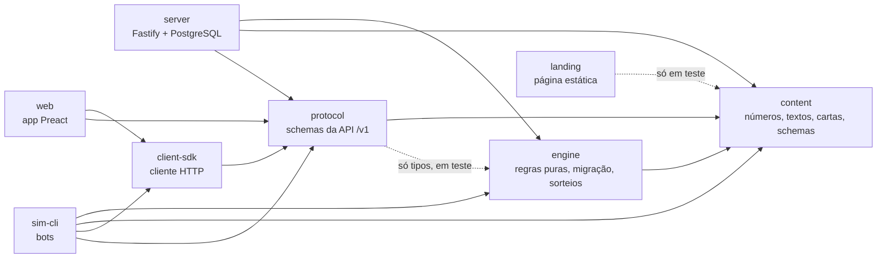

# Arquitetura da v0.2

O que está construído em Lords of the Guild depois da v0.2 "Estações e Conselho", como as peças se encaixam e onde a implementação se afasta do [Game Design Document](../GAME_DESIGN.md). O GDD §14 continua sendo o contrato; este documento descreve o estado real em **2026-10-02** e aponta para o código. Ele foi reescrito nessa data (lição 5 do [roadmap da v0.2](roadmap-v0.2.md), §10): a versão da v0.1 está no histórico do Git.

**Atualização de 2026-10-05.** A Fase G (respostas do autor, ADR 0016) subiu o estado para a versão 12 e a versão foi lançada com a tag `v0.2.0`; o parágrafo seguinte é o retrato de 2026-10-02. **No mesmo dia a Fase B da v0.3 subiu o estado para a versão 13** no `main` (V3B-T1; ADR 0017, decisão 9), sem mudar regra nenhuma: entra `state.ids`, os contadores de identidade das entidades que a v0.3 vai criar (`nextId`, que só sobe e nunca reutiliza um identificador), e o gerador passa a aceitar fluxos **por entidade** (`expedition:expedition-<n>`, `caravan:caravan-<n>`), que nascem no primeiro sorteio da entidade e são apagados quando ela termina. A guarda de forma confere os nomes dos fluxos, as quatro palavras de cada um e `rng` contra `ids` (nenhum fluxo de entidade além do contador). Os detalhes estão no [README do motor](../packages/engine/README.md), "Sorteios" e "Identidades". **Da Fase C já existem**, também no `main` e ainda não publicadas: os heróis no feudo com soldo e atraso (V3C-T1, versão 14) e a carta roteirizada "Estrangeira ferida", que entrega o primeiro herói a toda partida, com a forma de tratamento do herói e a lista dos prometidos (V3C-T3, versão 15). A chegada de um herói prometido é um instante novo da linha do tempo, processado logo depois do Conselho fora do sorteio. **E a Taverna** (V3C-T2, versão 16): o edifício `tavern`, os candidatos em rotação (`guild.tavernOffers`, sorteados no fluxo fixo `tavern`, o quarto de `RNG_STREAMS`), as ordens `hireHero` e `holdFestival`, os termos `tavern` e `devout` da moral e `tavern` no `ViewState`. A troca dos candidatos é outro instante novo da linha do tempo, ancorado na inauguração, processado depois das incursões e antes das planejadas automáticas; o fim do festival é da virada do dia. O resto deste documento é o retrato da v0.2 e não descreve essas três mecânicas (README do motor, "Heróis e soldo", "A carta roteirizada" e "Taverna"). O app mostra a guilda e a Taverna desde a V3C-T4: a aba Guilda (`#/guilda`), com os heróis, o soldo, o atraso, os candidatos e o festival, e os comandos `lords.hireHero`, `lords.dismissHero` e `lords.holdFestival`; para ela a visão ganhou `guild.text` e `guild.dismissText` (frases de `guildTexts`, no conteúdo), sem mudar regra nem versão do estado.

**Estado em 2026-10-02.** A v0.2 está implementada e publicada por fase no `main` (cada `push` com a CI verde é implantado sozinho), sem tag nem release, que são do autor. Às 23:21 UTC, a produção ainda respondia `protocol: 1` em `GET /v1/version` (a Fase C); a implantação das Fases D e E, enviadas às 23:04 UTC, não estava no ar. As regras são as premissas dos ADRs [0013](decisions/0013-regras-da-v0.2-tempo-ritmo-migracao-e-economia.md), [0014](decisions/0014-conselho-e-ameaca-na-v0.2.md) e [0015](decisions/0015-cronica-sem-o-fecho-diario-do-desperdicio.md), aplicadas por delegação e à espera da confirmação do autor ([pendencias-v0.2.md](pendencias-v0.2.md)). Os números da Ameaça estão sendo revistos no balanceamento de fechamento: este documento não os cita, e quem precisar deles lê o GDD §8.2 e `balance.threat` em `packages/content/src/balance.ts`.

Para o detalhe de cada pacote: [motor](../packages/engine/README.md), [servidor](../packages/server/README.md), [app web](../packages/web/README.md), [simulador](../packages/sim-cli/README.md), [página de apresentação](../packages/landing/README.md) e [implantação](../deploy/README.md).

## 1. Visão geral

O diagrama do GDD §14.1, atualizado para a instalação que está no ar em `https://lords.palsincomehub.com`.


A instalação é a da v0.1 ([ADR 0009](decisions/0009-implantacao-no-coolify.md)): três recursos no Coolify mais a página de apresentação, a borda no proxy da plataforma, app e API na mesma origem, deploy automático a cada `push` no `main`. A v0.2 não criou tabela, rota de infraestrutura nem recurso novo: tudo o que ela acrescentou ao jogo vive dentro de `games.state` e de `game_events`. As rotas novas são `GET /v1/catalog` e os campos novos de `POST /games`.

Os princípios do GDD §14.1 valem como estão: o servidor é autoritativo e é o relógio; o motor é um só (servidor, simulador e testes); estado inicial, semente e log de comandos refazem uma partida que nasceu na versão atual (a de uma partida migrada tem um limite, ver 4.4); o avanço é preguiçoso, então uma queda do servidor não perde nada.

## 2. Pacotes e direção das dependências



A seta aponta para o que é importado. As regras, impostas por `no-restricted-imports` em [`eslint.config.js`](../eslint.config.js):

- `engine`, `content` e `protocol` não importam `fastify`, `pg`, Drizzle nem módulos do Node. Arquivos de teste ficam fora da regra.
- `server` e `web` nunca importam um ao outro.
- `web` não importa o motor nem, fora dos testes, `@lotg/content` e o `contentHash` de `@lotg/protocol` (que lê o catálogo inteiro). `packages/web/src/bundle.test.ts` compila o app e confere que nenhum número, frase, flag ou efeito escondido do conteúdo chega ao navegador: do conteúdo só entram as listas de identificadores que os schemas do protocolo usam.
- `landing` não importa pacote nenhum do jogo. Só os testes dela leem `content`, para conferir as frases da Crônica que a página cita.
- `protocol` depende do motor apenas como dependência de desenvolvimento: um teste de igualdade de tipos faz o `pnpm typecheck` quebrar se `Command`, `ViewState` ou os códigos de recusa divergirem entre os dois.

Os pacotes são consumidos como fonte TypeScript (`exports` aponta para `src/index.ts`). Só o que é implantado tem build: o servidor (um único `dist/main.js`, com esbuild), o app (`packages/web/dist`, com Vite) e a página de apresentação (`packages/landing/dist`, com Vite).

## 3. Onde fica cada responsabilidade

**O servidor orquestra, o motor decide, o app exibe.**

| Responsabilidade | Onde fica |
|---|---|
| Regras de jogo: produção, estações, estoque, obras e filas, ofício, moral, Conselho, Ameaça, incursões, objetivos | `packages/engine` (`advanceTo`, `applyCommand`) |
| Números, textos, cartas e frases da Crônica | `packages/content` (`balance.ts`, `buildings.ts`, `cards/`, `chronicle.ts`, `objectives.ts`, `tiles.ts`) |
| Leitura de um estado gravado em qualquer versão | `migrateState`, em `packages/engine/src/migrations.ts` |
| Sorteios | `packages/engine/src/random.ts`, só dentro de `advanceTo` |
| O que a interface mostra, com a explicação de cada número e a névoa da Ameaça | `deriveViewState` e os `*View.ts` do motor |
| Forma dos comandos, das respostas e dos erros da API | `packages/protocol` (zod) |
| Faixas e regras de um comando (recusa com frase em português) | Motor; o servidor responde `422 GAME_RULE` |
| Relógio, autenticação, propriedade da partida, lock, migração gravada, persistência, recibos | `packages/server` |
| Opções de nova partida e conferência do ritmo pedido | Servidor (`src/catalog.ts`, `GET /v1/catalog`) |
| Recusa de um cliente de outro protocolo (`426`) | Servidor (`src/plugins/errors.ts`) |
| Conversão entre tempo real e tempo de jogo | Servidor (`gameTimeAt`, em `games/repository.ts`) e `deriveViewState` |
| Filtro de apresentação da Crônica (sem viradas de dia nem fecho do desperdício) e a nota "Sua escolha voltou" no Markdown | Servidor (`chronicleRows`, `games/chronicleMarkdown.ts`) |
| Avanço de partidas paradas (migrando-as) e expurgo de contas excluídas | Jobs do servidor, sob advisory lock (uma réplica por rodada) |
| Renovação de sessão, retentativas de rede, mesmo `commandId` no reenvio, cabeçalho do protocolo | `packages/client-sdk` |
| Estado da interface, ciclo de atualização, cache com marca de versão, avisos, diálogos | `packages/web` (`app/controller.ts`, `game/gameSession.ts`) |
| Relatório de Retorno em três blocos e "Antes de partir", montados só com a visão e os eventos | `packages/web/src/game/returnReport.ts` e `beforeLeaving.ts` |
| Credenciais e cache no navegador, sincronização entre abas | `packages/web/src/services` (`localStorage`, Web Locks, evento `storage`) |
| Balanceamento: bots que jogam só com a visão, matriz e faixas | `packages/sim-cli` |
| TLS, redirecionamento, rotas por caminho | Proxy do Coolify |
| Cabeçalhos de segurança do app (CSP, `nosniff`, HSTS) | Caddy da imagem `web` |
| Apresentação do jogo a quem ainda não joga | `packages/landing`, servida pelo Caddy da imagem `landing`, em outro domínio |
| Backup do banco | Agendamento do Coolify |
| Implantação a cada `push` no `main` | Job `deploy` de `.github/workflows/ci.yml`, pela API do Coolify |

O app não faz conta sobre o jogo. Quando a interface precisou de um número ou de uma frase que não estava no `ViewState`, ela foi acrescentada no motor: na v0.2, por exemplo, `winter` e `calendar.nextSeason.firewood` (a conta da lenha), `resources[].fullInSeconds`, `constructions.planned[].waiting`, `perNewWorkerPerHour`, `morale.next`, `council.pending[].defaultOptionId`, `threat.incoming.defenseText` e `objectives[].missing`. Há uma exceção registrada: `previewAllocation`, no app, repete a ordem de saída das levas em adaptação só para a prévia antes de confirmar uma alocação (pendência C-15); um teste em navegador a compara com o servidor.

## 4. O estado e as versões

### 4.1 Um JSON inteiro por partida

O `GameState` inteiro fica em `games.state` (JSONB), sempre escrito por completo, nunca em pedaços. A v0.2 fez o estado crescer de 1 para 11 versões sem uma migração de SQL sequer: mudar a forma do estado não muda o esquema do banco. A coluna `games.schema_version` é só um espelho para consultas (`select schema_version, status, count(*) from games group by 1, 2`).

Quatro coisas têm versão, cada uma com o seu tratamento ([README do servidor](../packages/server/README.md), "O que tem versão"):

| O quê | Número | Quando muda |
|---|---|---|
| Estado da partida | `state.schemaVersion` (hoje 24) | Uma tarefa muda a forma do `GameState`: um passo de migração por versão |
| Conteúdo | `contentHash` em `GET /version` e `GET /catalog` | Qualquer número, texto ou carta de `@lotg/content`; o conteúdo vai na imagem e não é gravado no banco |
| Protocolo | `protocol` em `GET /version` (hoje 3); o cliente manda `X-Lords-Protocol` | Uma mudança que o app antigo não consegue ler (ver seção 10) |
| Recibos de comando | Nenhum | Nunca são reescritos: o reenvio devolve a resposta da época, byte a byte |

### 4.2 `migrateState`

Um estado gravado só entra no motor por `migrateState(stored, { timeScale })`. Ela é pura, sequencial (1 → 2 → … → 11), idempotente e **confere a forma exata** de cada versão antes de mexer, também quando o estado já diz ser da versão atual: o número não é salvo-conduto. O que ela não conhece é recusado com `StateMigrationError` (`future` para uma versão mais nova que a do motor; `invalid` para uma forma inesperada), com o caminho do campo e o tipo, nunca o valor.

| Versão | Tarefa | O que entrou |
|---|---|---|
| 2 | V2B-T1 | `settings.difficulty` e `settings.timeScale`; `migratedAtMs` |
| 3 | V2C-T1 | O frio (`settlement.cold`) |
| 4 | V2C-T2 | Celeiro e Armazém em `buildings`; desperdício por relatar |
| 5 | V2C-T5 | Duas posições de fila; `autoStart` nas planejadas |
| 6 | V2C-T3 | Coortes de adaptação, experiência e mestria do ofício |
| 7 | V2C-T4 | Moral e efeitos temporários de moral |
| 8 | V2D-T1 | O Conselho (`council`) |
| 9 | V2E-T1 | Torre de Vigia; `map` (tiles e Ameaça); `horde` |
| 10 | V2E-T2 | A Paliçada em `buildings` |
| 11 | V2E-T3 | Os feridos (`settlement.injured`) e a incursão do roteiro marcada |

O detalhe de cada passo, a receita para acrescentar uma versão e os retratos congelados (`packages/engine/src/__fixtures__/`) estão no [README do motor](../packages/engine/README.md), "Versões do estado e migração". Os objetivos 5 a 10 (V2E-T4) não mudaram a forma: uma partida gravada antes deles fica fora do repouso e é acomodada na fronteira, antes de o tempo andar (seção 6).

### 4.3 A fronteira

`migratedAtMs` é o instante de jogo em que a **última** migração encontrou a partida, isto é, até onde uma versão anterior das regras a simulou ([ADR 0013](decisions/0013-regras-da-v0.2-tempo-ritmo-migracao-e-economia.md), decisão 4). A v0.2 chegou à produção em mais de uma publicação, então **a fronteira é de cada passo**: `migrateWith` entrega a cada passo o `lastProcessedAt` da partida naquele momento (`context.boundaryMs`), e todo prazo que um passo cria conta dali (a primeira carta, a Ameaça, a incursão do roteiro). Nada da ausência anterior é recalculado com uma regra que não existia; o estoque acima do novo limite fica; um passo não emite eventos (quem abre o frio de uma partida parada no inverno é o primeiro `advanceTo`, na fronteira).

### 4.4 No servidor

`loadGame` (`packages/server/src/games/repository.ts`) chama `migrateState` sob o lock da partida, em toda leitura, todo comando e no job de avanço; o resto do servidor só enxerga o estado na versão atual. A migração é gravada pela primeira escrita daquela transação, com um único incremento de `state_version`. Duas requisições simultâneas migram uma vez. `persistState` confere também o estado que vai gravar (`assertStorable`). Um estado ilegível termina em `500` **sem nada gravado por cima**; o job conta a falha, registra a causa da primeira e segue com as outras partidas.

**Limite conhecido.** O instante de cada migração depende de quando a partida foi gravada pela última vez antes da publicação, e isso não se deduz da semente nem dos comandos. Refazer por replay uma partida migrada exige o estado gravado em cada fronteira (um backup); o estado guarda só a mais recente (pendência B-4).

## 5. Sorteios

O motor sorteia com um gerador próprio, com semente, em `packages/engine/src/random.ts` (V2B-T2): xoshiro128\*\*, só com operações inteiras, e **fluxos nomeados**, cada um com o próprio estado em `state.rng[nome]`:

| Fluxo | Quem sorteia | Desde |
|---|---|---|
| `morale` | A chegada de um colono e a partida de um aldeão, na virada do dia | V2C-T4 |
| `council` | A carta de cada audiência | V2D-T1 |
| `horde` | A incursão que a Ameaça marca | V2E-T3 |

- Sortear em um fluxo não desloca os outros. O fluxo nasce na primeira vez em que é usado (semente por FNV-1a mais SplitMix32 sobre `seed:nome`), então uma partida da v0.1 entrou com `rng: {}` sem mudar de forma.
- **Só `advanceTo` sorteia**, em instantes da linha do tempo, nunca em um comando, na visão, em `nextEventAt`, na criação ou na migração: consultar a tela a cada 30 segundos não rerrola nada, e um recibo reenviado nem chega ao motor. `purity.test.ts` barra a importação de `random.ts` nesses módulos.
- **Só se sorteia o que pode acontecer**: sem vaga, no piso de população, sem carta elegível, com uma incursão já marcada, o fluxo não anda.
- O estado do gerador é gravado com a partida e **nunca** sai no `ViewState`. A divisão de intervalo é provada com os sorteios de verdade no caminho, nos três fluxos (`economy.property.test.ts`, `council.property.test.ts`, `threat.raids.test.ts`).
- Trocar o algoritmo é mudar uma regra: `RNG_VERSION`, vetores de referência em `random.test.ts` e um passo de migração.

## 6. A linha do tempo e a ordem do mesmo instante

`advanceTo` anda trecho a trecho até o próximo evento de `nextEventAt` e aplica a produção contínua em cada trecho, com aritmética inteira (milésimos e frações `{ num, den }`). Na v0.2 a linha do tempo tem estes instantes: fim de obra, chegada de aldeão, virada de dia, fim de uma leva em adaptação, comida ou lenha acabando, estoque enchendo, planejada automática juntando o custo, carta que expira, efeito escondido que acontece, continuação que chega, incursão que chega, aviso da Torre para ela e ferido que sara. A v0.3 acrescenta, com os heróis (V3C-T1), o ouro acabando com soldo a pagar.

A invariante, testada por propriedade e sem tolerância, vale no estado, nos eventos e no gerador: `advanceTo(t2)` ≡ `advanceTo(t1)` seguido de `advanceTo(t2)`.

**Ordem fixa dentro do mesmo instante** (`processEventsAt`, em [`packages/engine/src/advance.ts`](../packages/engine/src/advance.ts); provada em `advance.test.ts`, "no mesmo instante a ordem é fixa"):

1. Obras concluídas.
2. Aldeões que chegam: os recrutas e, depois, os feridos que saram e voltam ao ofício.
3. A virada do dia (`processCalendar`), ela mesma em ordem fixa: o fecho do desperdício do dia que acabou; o ano (e a lista de cartas vistas no ano, que zera); a estação (e a conta das estações sem frio); o amanhecer; a experiência do ofício; a moral (recálculo, sorteio do colono, sorteio da partida, deserção por fome); desde a V3C-T1, a cobrança do soldo em atraso (`turnWages`: quem fica Descontente e os heróis que partem), logo depois da deserção e antes do Conselho; o sorteio do Conselho, que vem depois da moral porque a faixa de moral é requisito de carta; e, por último, a Ameaça (subida, uivos do roteiro, sorteio da incursão).
4. O Conselho fora do sorteio (`settleCouncil`): cartas que expiram, efeitos escondidos que acontecem, continuações que chegam, nessa ordem.
5. Fim de adaptação de quem trocou de ofício.
6. As incursões (`settleRaids`): o aviso da Torre e a resolução das que chegaram.
7. Início automático das planejadas e objetivos (`settlePlanned`, que repete os dois enquanto um der motivo ao outro).
8. Fome e frio e, por último, o soldo em atraso, que abre ou fecha (`settleScarcity`).

Depois de tudo, `advanceWith` registra os estoques que encheram (`announceFilled`). Consequências que a ordem decide: a Paliçada que termina no instante do ataque já o repele (obras antes das incursões); a moral do instante de uma incursão é a de antes dela (virada antes das incursões); o ferido que sara na virada já conta para a experiência do ofício; a carta que expira no instante de um comando é resolvida antes dele (`applyCommand` exige o estado avançado), e a resposta encontra `CARD_EXPIRED`.

**Repouso.** Depois de cada instante e de cada comando: nenhuma planejada automática pode começar, nenhum objetivo ativo está cumprido, a fome, o frio e o soldo em atraso não têm o que abrir ou fechar, nenhuma carta está vencida na mesa, nenhum aviso da Torre está por dar. Por isso `nextEventAt` é sempre depois de agora e nenhum instante é processado duas vezes. Um estado que chega fora do repouso (recém-migrado, ou com uma lista de objetivos que cresceu) é acomodado no instante em que está, **antes** de o tempo andar. Todo encadeamento tem limite derivado de conteúdo finito (listas de planejadas e de objetivos, uma incursão marcada por vez, no máximo duas cartas na mesa).

**Previsões.** A visão anuncia prazos ("cheio em", "acaba em", a espera de uma planejada, a conta da lenha, a moral da próxima virada) andando uma cópia do estado só com a produção contínua, o ofício e a moral, **sem sortear nada e sem as incursões marcadas**, que são segredo até os vigias as verem. Um prazo anunciado é o de quem não é atacado no caminho.

## 7. Os relógios

Há três relógios, e cada um tem um dono.

**Tempo de jogo (motor).** Milissegundos inteiros desde o início da partida; o motor recebe o instante como argumento e não conhece o relógio do sistema. Todos os números do conteúdo estão no ritmo Normal do GDD: um dia do calendário são 2 horas de jogo (`calendar.dayMs`), o ano tem 84 dias (primavera, verão e outono de 24, inverno de 12). As constantes de prazo são tempo de jogo e escalam com o ritmo ([ADR 0013](decisions/0013-regras-da-v0.2-tempo-ritmo-migracao-e-economia.md), decisão 1), **com as exceções que o conteúdo marca com `…RealMs`** ([ADR 0016](decisions/0016-respostas-do-autor-as-pendencias-da-v0.2.md)): o prazo de resposta de uma carta do Conselho (`council.expiryRealMs`, 24 h reais), a carência e o passo da deserção por fome (`morale.famineDesertionAfterRealMs` e `famineDesertionEveryRealMs`, 12 h e 2 h reais), a janela em que a fome que reabre é a mesma (`morale.famineResumeWithinRealMs`, 2 h reais) a antecedência do aviso da Torre de Vigia (`threat.watchtowerLevels[].warningRealMs`, 1 h e 2 h reais) e, desde a V3C-T1, os quatro prazos do soldo em atraso (`heroes.arrears`: `discontentAfterRealMs`, 12 h; `leaveAfterRealMs`, 24 h; `leaveEveryRealMs` e `resumeWithinRealMs`, 2 h reais; [ADR 0017](decisions/0017-regras-da-v0.3-herois-taverna-e-soldo.md), decisão 3). O motor as converte em tempo de jogo com `state.settings.timeScale` (`realToGameMs`). Consequência: "as mesmas ordens dão o mesmo feudo em qualquer ritmo" vale até uma carta expirar, uma fome passar da carência ou os vigias darem um alarme (o desfecho da incursão é o mesmo; o instante do alarme, não).

**Tempo real (servidor).** O servidor é o único relógio (`ctx.clock()`, nunca `Date.now()` solto):

```
tempo de jogo = (agora − criação da partida) × time_scale
```

`games.time_scale` é gravado na criação e não muda: é o ritmo escolhido entre os oferecidos (3, 1 ou 0,5) ou, sem escolha, `GAME_TIME_SCALE` (padrão 3, de 0,5 a 10). O mesmo valor fica em `state.settings.timeScale`, e `loadGame` recusa a partida em que os dois divergem. O tempo de jogo nunca anda para trás. O avanço é **preguiçoso**: acontece nas leituras e nos comandos; um job avança e migra as partidas sem estado persistido há mais de uma hora; não há temporizador por partida em memória.

**Visão em tempo real (interface).** `deriveViewState(state, gameTimeMs, { timeScale })` entrega prazos em segundos reais (arredondados para cima; `depletesInSeconds` e `famine.secondsElapsed`, para baixo), taxas por hora real e textos de explicação já com esses números. O app não converte nada: do ritmo ele só recebe rótulos prontos (`settlement.paceLabel`) e, nas boas-vindas, as opções de `GET /catalog`. O que o app faz com o tempo:

- Ciclo de 30 s com a aba à vista (2 min em segundo plano): `GET /view` com ETag e `GET /events?after=`. A leitura seguinte vem antes quando uma obra, a espera de uma planejada ou uma adaptação termina (`nextPollMs`). Entre dois ciclos, as contagens regressivas andam no relógio do navegador.
- O Relatório de Retorno sai ao abrir a página depois de 4 horas reais sem leitura e, desde a v0.2, também na volta de uma aba que ficou **fora de vista** por 4 horas ou mais (a ausência vai para o cache, porque o navegador pode descartar a aba).
- Os limiares de apresentação são de tempo real e ficam no app, sem número de regra: "cheio em" com alerta abaixo de 8 h, "Antes de partir" olhando 24 h, o aviso de estação uma hora antes, o lembrete "Proteja seu reino" 48 horas depois da primeira vez no navegador.

No ritmo Rápido, um dia de jogo dura 40 minutos reais, uma estação de 24 dias, 16 horas, e o ano, 56 horas. Os testes de integração e em navegador rodam com `GAME_TIME_SCALE=1`, porque foram escritos nos tempos do GDD; o ritmo 3 tem testes próprios no motor, no servidor (`pace.test.ts`) e quatro cenários em navegador ("no ritmo da produção").

## 8. O Conselho

O motor do Conselho fica em `council.ts` (o que não sorteia), `councilTurn.ts` (o sorteio) e `councilView.ts` (a visão); as cartas, em `packages/content/src/cards/` ([README do motor](../packages/engine/README.md), "Conselho do Feudo"; [ADR 0014](decisions/0014-conselho-e-ameaca-na-v0.2.md)).

- **Cadência ancorada.** Uma audiência a cada 4 dias de jogo, sempre em uma virada de dia; quando o instante chega, a próxima anda um intervalo, haja carta ou não. No máximo 2 cartas na mesa: com a mesa cheia, o sorteio daquele instante é pulado. A continuação de uma cadeia tem prioridade sobre o sorteio, e chega no primeiro lugar que se abrir.
- **Expiração** em 24 h reais: o conselho aplica a opção marcada para a dificuldade (`autoResolve`), que nunca tem custo, ou, se a carta marca `autoResolveIfUnlocked` e o feudo já tem o que ela exige, essa opção.
- **Resposta** é o comando `answerCard { instanceId, optionId }`, pelo mesmo recibo transacional de toda ordem: duplo clique, duas abas e resposta atrasada não pagam nem recompensam duas vezes. Não sorteia nada.
- **Efeito escondido** só existe em `council.delayed` até a virada marcada, quando vira evento (`cardEffectApplied`). Antes disso não sai na resposta, na visão nem na previsão da moral.
- **Privacidade narrativa.** Flags, efeitos escondidos, continuações agendadas e o gerador nunca saem do servidor; o nome de uma flag não é texto de interface. O teste do pacote do app procura, pelo nome, que nada disso chegue ao navegador.
- **Ids fixos.** Uma carta que o catálogo já não tem sai calada e não ocupa lugar; por isso os ids de carta e de opção publicados são fixados em `packages/content/src/council.test.ts`, e mudar um deles pede um passo de migração.
- **"Sua escolha voltou."** O evento da continuação leva a escolha anterior (`previousCardId`, `previousOptionId`, `previousInstanceId`); o servidor escreve, no Markdown da Crônica, a nota que a cita (`games/chronicleMarkdown.ts`), e a aba Crônica leva o foco à linha citada.

## 9. A Ameaça e as incursões

As regras ficam em `threat.ts`, `hordeTurn.ts` (o sorteio) e `raids.ts` (roteiro, aviso, resolução e feridos, sem sortear nada); os números em `balance.threat` e `balance.raids`, e os tiles em `tiles.ts` (GDD §8.2 e §12.3; ADR 0014, decisões 10, 11 e 20).

- **Tiles abstratos.** O Covil de Lobos é um tile sem mapa (`map.tiles`); o mapa gráfico é da v0.5. A Ameaça (`map.threat`) sobe na virada do dia com os tiles ativos e com o outono, e cai a cada incursão, repelida ou sofrida.
- **A névoa é aplicada no servidor.** `ViewState.threat` é uma união fechada: sem a Torre de Vigia (`known: false`) só saem a frase, a Torre e a defesa; o número, a tendência, os tiles e as incursões marcadas não saem, e o schema do protocolo recusa o resto. Os eventos só levam a Ameaça para quem tem a Torre. Testes conferem que dois feudos iguais, um com a Ameaça em zero e outro com uma incursão à porta, têm a mesma visão sem a Torre.
- **Incursões marcadas** (`horde.scheduledRaids`, no máximo uma por vez): a do roteiro do ano 1 nasce com a partida (os uivos no 10º dia, os lobos no 16º); as outras são sorteadas pela Ameaça na virada do dia e chegam em outra virada. O sorteio não vira evento nem linha: a incursão só aparece quando os vigias a avistam e, sem Torre, quando chega.
- **Torre e Paliçada**, até o nível 2. A Torre só deixa ver (antecedência do aviso; no nível 2, o tamanho). A regra inteira da Paliçada é `palisadeAgainst(nível, tamanho)`: aberta, segura ou rompida pela metade.
- **Feridos** não trabalham por um dia de jogo, continuam comendo e voltam sozinhos ao edifício de onde saíram; ninguém parte por causa dos lobos.

O comportamento medido em 2026-10-02 (a Ameaça sobe até perto do máximo e fica lá, e quase toda incursão sorteada é média) está em [balance-v0.2.md](balance-v0.2.md), seção 14.4, e é o que o balanceamento de fechamento (V2F-T1) está revendo.

## 10. O catálogo, o protocolo e o 426

**`GET /v1/catalog`** (V2B-T3; GDD §14.5) traz as opções de nova partida: dificuldades e ritmos com os textos do conteúdo e os padrões (`defaults`). Não tem autenticação, é montado uma vez no arranque e tem ETag fraco (SHA-256 do corpo). Os fatores de regra de cada dificuldade **não** saem: o app mostra a frase, quem aplica o fator é o motor. O catálogo só traz isso; o resto do que o app exibe vem no `ViewState`. `POST /games` aceita `difficulty` e `timeScale`; quem confere o ritmo contra os oferecidos é o servidor (`OfferedGameRequestSchema`), e não o protocolo, porque ler `balance` no protocolo levaria a tabela de números ao navegador.

**Protocolo 2** (V2D-T1). O `ViewState` cresce por adição, e adição não sobe o protocolo: uma aba antiga continuou funcionando nas Fases B e C. Com o Conselho, `pendingDecisions` deixou de ser sempre vazio e passou a trazer cartas que o app do protocolo 1 não sabe ler. Por isso `PROTOCOL_VERSION` é 2, o SDK manda `X-Lords-Protocol` em toda chamada e o servidor responde `426 UPGRADE_REQUIRED` ("Há uma versão nova do jogo. Recarregue a página.") a quem manda outro número. Quem não manda o cabeçalho (o monitor de saúde, um `curl`) é atendido. As rotas continuam em `/v1`: o GDD dizia que mudanças incompatíveis iriam para `/v2` (pendência B-9).

**Protocolo 3** (V3D-T1; ADR 0018, decisão 11). `pendingDecisions` é uma união **fechada** por `kind`: no protocolo 2 só havia `card`, e um teste recusava qualquer outro tipo. Com as expedições, a equipe parada em uma encruzilhada entra na lista (`kind: 'crossroads'`, com o identificador da expedição, o título e o prazo real), e o app do protocolo 2 recusaria a visão inteira ao ver uma. Por isso `PROTOCOL_VERSION` é 3, e o cliente anterior recebe o mesmo `426`, em leitura e em ordem, sem que nenhum recibo seja gravado nem reescrito (`packages/server/test/expeditions.test.ts`). `packages/server/src/plugins/errors.ts` não mudou: ele já comparava `X-Lords-Protocol` com o número. Os comandos novos (`sendExpedition`, `chooseExpeditionPath`), os campos da Guilda dos Aventureiros na visão (`guild.built`, `available`, `expeditions`, `reports`) e as recusas novas são adição e não subiriam o número sozinhos. Um terceiro tipo de decisão pendente (uma caravana, por exemplo) sobe de novo.

**Ordem de implantação.** O job `deploy` implanta a API antes do app, então por alguns segundos uma aba antiga fala com a API nova: ela recebe o `426` e o aviso de recarregar. O cache do app tem a marca da versão (`CACHE_VERSION`: protocolo e formato da visão); o de outra versão é descartado, e a primeira volta depois de uma atualização sai sem a comparação dos estoques (pendência B-11).

## 11. O caminho de um comando

`POST /v1/games/:id/commands` com `{ commandId, type, payload }`. Tudo acontece em uma transação (`packages/server/src/games/commands.ts`):

```mermaid
sequenceDiagram
    participant App as App web
    participant API as API
    participant Eng as Motor
    participant DB as PostgreSQL

    App->>API: POST /commands { commandId, type, payload }
    API->>API: X-Lords-Protocol diferente? 426
    API->>DB: autentica (conta e sessão, sem cache)
    API->>DB: lockGame (SELECT … FOR UPDATE, filtrado pela conta)
    API->>Eng: migrateState (estado gravado → versão atual)
    API->>DB: busca recibo por (game_id, commandId)
    alt recibo existe, mesmo conteúdo
        API-->>App: status e corpo originais + X-Lords-Replayed
    else recibo existe, conteúdo diferente
        API-->>App: 409 COMMAND_ID_CONFLICT
    else comando novo
        API->>Eng: advanceTo(estado, agora em tempo de jogo)
        API->>Eng: applyCommand(estado avançado, comando)
        API->>DB: persistState (estado inteiro, migração incluída, eventos, state_version + 1) e recibo
        alt aceito
            API-->>App: 200 { view, events, stateVersion }
        else recusado pelo motor
            Note over API,DB: o avanço e o recibo são gravados; a ação não tem efeito
            API-->>App: 422 GAME_RULE, com o estado avançado em details
        end
    end
```

Pontos que sustentam o contrato ([ADR 0004](decisions/0004-comandos-e-cache-http.md)):

- O recibo guarda o hash do pedido, o status e o corpo completo da resposta, enquanto a partida existir. Um reenvio nunca reaplica a ordem, nem depois de um reinício do servidor, nem depois de uma migração: devolve o corpo da época e não migra nem grava nada.
- Uma recusa faz commit antes do 422: o desfecho sai da transação como valor e o erro é lançado depois. Uma falha inesperada desfaz tudo, migração incluída.
- No app, uma ordem nasce em `controller.prepare`, que fixa o `commandId`; "Tentar de novo" reenvia a mesma ordem com o mesmo identificador. Ordens nunca ficam em fila local.
- As ordens das obras levam `targetLevel` opcional (o nível que a tela mostrava): duas abas com a visão atrasada não pagam um nível que ninguém pediu (`STALE_LEVEL`).
- As leituras (`GET /view`, `/events`, `/chronicle`) passam pelo mesmo lock e avançam o mundo, mas só escrevem no banco se o avanço produziu eventos ou se o estado acabou de ser migrado.

## 12. Divergências aceitas em relação ao GDD

O GDD (versão 0.7) e os roadmaps foram atualizados para refletir as decisões abaixo; a lista serve para quem compara o que foi construído com o desenho original.

### 12.1 Decisões do autor (da v0.1)

| Divergência | Sustentação |
|---|---|
| A API roda no host em desenvolvimento | [ADR 0001](decisions/0001-api-no-host-em-dev.md) |
| `@types/node` e `@types/pg` fora da lista de bibliotecas, aprovados depois | [ADR 0006](decisions/0006-types-node.md) |
| A Crônica não traz as viradas de dia; `GET /events` traz | [ADR 0007](decisions/0007-cronica-sem-viradas-de-dia.md) |
| O cliente é um app web com aparência de editor, e não uma extensão do VS Code | [ADR 0008](decisions/0008-cliente-web-com-aparencia-de-editor.md) |
| Produção no Coolify, com o proxy da plataforma na borda | [ADR 0009](decisions/0009-implantacao-no-coolify.md) |
| `GET /version` informa o que está ligado (`features.githubDevice`) | [ADR 0010](decisions/0010-version-informa-o-que-esta-ligado.md) |
| Ritmo 3× e visão em tempo real | [ADR 0011](decisions/0011-ritmo-3x-no-mvp.md) |
| O vínculo GitHub fica **desligado**; o código existe e só foi testado com um GitHub simulado | ADR 0008, ponto 2 |
| O lembrete "Proteja seu reino" conta 48 horas reais | ADR 0011, consequências |
| Página de apresentação em domínio próprio; oito pontos pendentes de confirmação | [ADR 0012](decisions/0012-pagina-de-apresentacao.md) |
| A v0.1 fechou sem playtest externo e sem evidência por critério | [acceptance-v0.1.md](acceptance-v0.1.md) |

### 12.2 Decisões da v0.2, aplicadas por delegação

Nenhuma foi respondida pelo autor; cada uma aguarda confirmação em [pendencias-v0.2.md](pendencias-v0.2.md), e uma resposta diferente vira mudança de conteúdo, golden e GDD no mesmo commit.

| Divergência ou leitura | Sustentação |
|---|---|
| Ritmos Rápido (3×), Normal (1×) e Tranquilo (0,5×); o "Rápido 2×" do GDD saiu. Tudo é tempo de jogo, menos a expiração da carta | [ADR 0013](decisions/0013-regras-da-v0.2-tempo-ritmo-migracao-e-economia.md), decisões 1 e 2 |
| Partidas da v0.1 migradas, com a fronteira de cada passo e o estoque acima do limite preservado | ADR 0013, decisão 4; pendência B-4 |
| O objetivo 4 desbloqueia (Celeiro, Armazém e Torre de Vigia) e dá 50 de ouro: a v0.2 saiu só com o desbloqueio, no lugar do ouro do [ADR 0002](decisions/0002-objetivo-4-v01.md), e o ouro voltou em 2026-10-05, sem pagamento retroativo | ADR 0014, decisão 12; [ADR 0016](decisions/0016-respostas-do-autor-as-pendencias-da-v0.2.md), item 7 |
| A Crônica também não traz o fecho diário do desperdício | [ADR 0015](decisions/0015-cronica-sem-o-fecho-diario-do-desperdicio.md) |
| Primeiro lote de 21 cartas, e não 60; nenhuma roteirizada; a carta do herói fica para a v0.3 | [ADR 0014](decisions/0014-conselho-e-ameaca-na-v0.2.md), decisões 7 e 8 |
| Torre e Paliçada até o nível 2; a Ameaça cai a cada incursão; incursões sorteadas pela Ameaça | ADR 0014, decisões 10 e 11 |
| Protocolo 2 com a versão no cabeçalho, sem `/v2` | Pendência B-9 |
| Publicação por fase no `main` (o roadmap previa branches de fase e o autor jogando cada uma antes do merge) | ADR 0013, decisão 3; [pendencias-v0.2.md](pendencias-v0.2.md), seção 1 |

### 12.3 O que o GDD descreve e ainda não existe

| Item | Estado |
|---|---|
| Catálogos de edifícios e cartas em `GET /catalog` (GDD §14.5) | O catálogo só traz as opções de nova partida; o `ViewState` leva o resto |
| "Baixar cópia da partida (JSON)" (GDD §13.6) | Não existe; existe "Baixar Crônica (Markdown)" |
| A Ameaça no cabeçalho (GDD §13.3) | Fica no painel "Ameaça" da aba Feudo |
| Hora da Vigília com efeito | É guardada e não muda nada (v0.4) |
| Notificações com a aba fechada | Nada chega com a aba fechada; com a aba em segundo plano, o título conta as novidades |
| O Relatório de Retorno para a aba que ficou **à vista** o tempo todo | Ela recebe os avisos e as linhas da Crônica de cada acontecimento, mas não o relatório |
| Mecânicas de versões futuras (exército, mapa gráfico, níveis 3 em diante da Torre e da Paliçada). Os heróis no feudo e a Taverna existem no `main` desde a Fase C da v0.3 (seção 14), o motor das expedições, desde a V3D-T1 (seção 15), os desfechos e o equipamento, desde a V3D-T2 (seção 16), o Mercado, sem tela, desde a V3E-T1 (seção 20), as caravanas, também sem tela, desde a V3E-T2 (seção 21), e os Mestres, também sem tela, desde a V3E-T3 (seção 22) | Fora do escopo, por regra do projeto: nem "só a estrutura" |

## 13. Limites conhecidos

Conferidos no código e nos registros em 2026-10-02. Não são decisões: são coisas a resolver ou a verificar. A lista completa, com o que cada fase deixou, está em [pendencias-v0.2.md](pendencias-v0.2.md), seção 5, e no Registro do [roadmap da v0.2](roadmap-v0.2.md), §11.

**Código**

| Limite | Onde |
|---|---|
| Refazer por replay uma partida migrada exige o estado de cada fronteira | `packages/engine/src/migrations.ts`; pendência B-4 |
| A dificuldade da linha (`games.difficulty`) não é conferida contra a do estado; só o ritmo é | `packages/server/src/games/repository.ts`; pendência B-5 |
| `GAME_TIME_SCALE` aceita um ritmo que o jogo não oferece, e a partida criada sem `timeScale` nasce nele | `packages/server/src/games/service.ts`; pendência B-12 |
| As previsões de lenha e de comida erram quando as duas acabam no mesmo inverno | `seasonView.ts`, `craftProjection.ts`; pendência C-8 |
| A prévia da alocação repete no app uma regra do motor | `packages/web/src/ui/workers.ts`; pendência C-15 |
| A visão tem de 10 a 15 kB (4,6 a 5,0 na v0.1) e cada recibo guarda uma; uma ordem depois de 30 dias fora no ritmo Rápido leva cerca de 2.200 eventos na resposta e no recibo | [balance-v0.2.md](balance-v0.2.md), seção 9.7; ADR 0004 |
| Os números de versão dos pacotes e de `GET /version` continuam `0.1.0` | `packages/server/src/version.ts` e os `index.ts` dos pacotes |
| Herdados da v0.1: botões de fechar dentro do `tablist`; `server_time` regredido se o relógio voltar; a corrida que `storageSettle` previne nunca foi reproduzida | `EditorTabs.tsx`, `games/commands.ts`, `services/sessionLock.ts` |

**Operação**

| Pendência | Origem |
|---|---|
| A reversão atravessando uma migração de estado nunca foi ensaiada com imagens; o procedimento está escrito | [`deploy/README.md`](../deploy/README.md), "Ensaios de reversão" |
| Backups no mesmo disco do banco; nenhum registro de cópia de `RECOVERY_CODE_SECRET` fora do Coolify; avisos do Coolify sem canal | Registro do MVP, F4-T2 a F4-T4; decisão 14 do roadmap da v0.2 |
| As consultas de playtest de `deploy/analytics/ops.sql` nunca rodaram em produção | Roadmap da v0.2, V2A-T1 |

**Verificação**

| O que não foi verificado | Origem |
|---|---|
| Ninguém além dos agentes jogou a v0.2; nenhum playtest com outras pessoas aconteceu | [acceptance-v0.2.md](acceptance-v0.2.md) |
| Só Chromium nos testes automáticos; Firefox, Safari, celular e leitor de tela não foram usados | Idem |
| Nenhum estado de produção passou pelas migrações antes de elas irem ao ar | [pendencias-v0.2.md](pendencias-v0.2.md), seção 5 |
| A carga com 50 bots e o volume da tabela `commands` não foram medidos com a visão da v0.2 | Idem |
| As capturas da página de apresentação mostram a bancada de antes da v0.2 | Roadmap da v0.2, V2F-T4.2 |

## 14. A Guilda (Fase C da v0.3, fechada em 2026-10-06)

O que a Fase C da v0.3 construiu por cima do retrato das seções 1 a 13. Está no `main` **local**, com o estado na versão 16, e **não está em produção**: por resposta do autor de 2026-10-06, a primeira publicação da v0.3 é a do fim da Fase D, e a produção salta do estado 12 direto para o dela ([ADR 0017](decisions/0017-regras-da-v0.3-herois-taverna-e-soldo.md), "Respostas de 2026-10-06"). O detalhe está no [README do motor](../packages/engine/README.md), "Heróis e soldo", "A carta roteirizada" e "Taverna"; as medições, em [balance-v0.3.md](balance-v0.3.md), seções 3 a 5.

**Estado** (versões 14 a 16, um passo de migração por tarefa, nenhum com prazo, evento, identificador ou sorteio): `state.guild` com `heroes` (teto `balance.heroes.rosterCap`, que conta os cativos; o limite de contratação não os conta), `arriving` (os heróis com nome que uma carta prometeu), `wageArrears` e `lastWageArrears` (no molde de `famine` e `lastFamine`), `tavernOffers` e `tavern` (`nextRotationAtMs`, `festival`, `lastFestivalAtMs`); `settlement.buildings.tavern`; o fluxo fixo `tavern` em `state.rng`. Atributos, poder, limite de heróis e preço exibido são derivados, nunca gravados.

| Peça | Onde | O que faz |
|---|---|---|
| Soldo e atraso | `economy.ts` (`netRates`, `goldCoversWages`), `wages.ts`, `scarcity.ts` | O soldo é consumo contínuo de ouro, em tempo de jogo. O atraso abre no instante em que o ouro acaba com soldo a pagar e fecha quando o saldo deixa de ser negativo: é o último passo de `settleScarcity`. As consequências (Descontente com 12 h reais, um herói a cada 2 h reais depois das 24 h, o Leal nunca) são cobradas em `turnWages`, **na virada do dia**, logo depois da deserção por fome. Os quatro prazos são tempo real, convertidos por `realToGameMs` |
| O que venceu é cobrado | `wageLedgerAt` (`wages.ts`), `famineLedgerAt` (`famine.ts`) | A virada que encontra o atraso (ou a fome) fechado **há menos de 2 h reais** ainda cobra o que a duração já devia. Vale para o soldo e para a deserção por fome da v0.2; confirmado pelo autor em 2026-10-06 |
| Heróis que chegam | `arrivals.ts` (`promiseHero`, `settleHeroArrivals`), `heroes.ts` | O único lugar que cria herói por carta. A chegada é um instante da linha do tempo, logo depois do Conselho fora do sorteio; o teto da lista faz a recompensa esperar, nunca se perder |
| A carta roteirizada | `councilTurn.ts`; conteúdo em `cards/scripted.ts` | "Estrangeira ferida", no 13º dia de jogo, na frente das sorteadas, uma vez por partida; pede lugar na mesa sem reservá-lo; chega também às partidas que já passaram do dia |
| Taverna | `tavern.ts` (contas), `tavernTurn.ts` (rotação e fim do festival: o único que sorteia e cria `offer-<n>`), `tavernOrders.ts` (`hireHero`, `holdFestival`: não sorteiam) | A rotação é ancorada na inauguração e tem instante próprio em `nextEventAt`, processado depois das incursões e antes das planejadas; o festival acaba em uma virada de dia. A moral ganhou os termos `tavern` e `devout` |
| Visão | `guildView.ts`, `tavernView.ts` | `guild` (heróis com o poder explicado, os prometidos, o soldo com `coveredForSeconds`, `afterArrivals`, `arrears` e `lingering`, e as frases `text` e `dismissText`) e `tavern` (sempre presente). Prazos em segundos reais; o modelo do candidato (`templateId`), o gerador e o objeto `ids` não saem. O protocolo continua 2: a visão cresceu por adição |
| Servidor | sem rota nova | As ordens `dismissHero`, `hireHero` e `holdFestival` passam pelo caminho de todo comando (seção 11); as recusas são do motor (`HERO_NOT_FOUND`, `TAVERN_REQUIRED`, `OFFER_GONE`, `HERO_LIMIT`, `FESTIVAL_ALREADY_HELD`, `INSUFFICIENT_RESOURCES`) |
| App | `tabs/Guild.tsx`, `components/HeroesPanel.tsx` e `TavernPanel.tsx`, `ui/guild.ts`, `game/intent.ts` | A aba fixa `#/guilda`; a linha "Guilda" na árvore; o soldo em atraso na barra de status, depois da fome e do frio; `lords.hireHero`, `lords.dismissHero` e `lords.holdFestival` na paleta, todos por `controller.prepare`. "Tentar de novo" vale só para o feudo e a intenção em que nasceu (`intentOf`) |
| Simulador | `bots/explorador.ts`, `bots/policies.ts` (`contratar`, `dar festival`) | O perfil Explorador está na rodada padrão da matriz, com faixa; as colunas `heroes`, `wage_arrears_hours` e `heroes_departed` são medidas |

**O que ainda não existe, e é erro antecipar:** expedições, encruzilhada e Postura, ferimento, captura, experiência ganha, equipamento e inventário, o edifício Guilda (Fase D); Mercado, caravanas e Mestres (Fase E); o lote 2 de cartas e os objetivos 11 a 16 (Fase F). Na Fase C todo herói está no feudo (`status: 'idle'`), e cinco dos oito traços ainda não têm efeito ([pendencias-v0.3.md](pendencias-v0.3.md), C-58).

**Limites conhecidos da fase:** ninguém além dos testes e dos bots jogou com heróis (o roteiro de 15 minutos para o autor está em [pendencias-v0.3.md](pendencias-v0.3.md), seção 7); nenhuma partida de produção passou pelos passos 12 → 16; o ouro parado não caiu ([balance-v0.3.md](balance-v0.3.md), seção 5).

## 15. As expedições (V3D-T1, 2026-10-06)

O que a primeira tarefa da Fase D construiu por cima da seção 14: **o motor das expedições**, sem a interface, sem o catálogo e sem os desfechos sobre o herói. Está no `main` **local**, com o estado na versão 17 e o protocolo 3, e não está em produção. O detalhe está no [README do motor](../packages/engine/README.md), "Expedições"; as decisões do agente, em [pendencias-v0.3.md](pendencias-v0.3.md), "Fase D".

**Estado** (versão 17; o passo `v16ToV17` não cria prazo, evento, identificador nem sorteio): `settlement.buildings.guild` (a Guilda dos Aventureiros, até o nível 4), `guild.expeditions` (até 3, em ordem de identificador), `guild.reports` (os 3 últimos) e o herói com `status: 'expedition'`. A guarda exige que todo fluxo `expedition:<id>` em `rng` seja de uma expedição em curso.

| Peça | Onde | O que faz |
|---|---|---|
| Conteúdo | `packages/content/src/expeditions.ts`, `missions/`, `balance.expeditions`, `buildings.guild` | Um modelo tem três variantes, e cada variante é um grafo acíclico de nós que termina em um retorno. **Dois modelos provisórios** (a Patrulha dos Arredores e a Floresta Antiga); o catálogo é de V3D-T3. `expeditionModelsSchema` confere o grafo contra os limites do conteúdo |
| Contas | `expeditions.ts`, `heroes.ts` (`teamPower`), `hash.ts` | Não sorteiam nem dão identificador: a variante (um hash da semente e do modelo mais o número de envios), o fator de duração da estação, o poder da equipe contra um nó (com os pesos de atributo do nó), o desfecho por multiplicação cruzada, o que a Postura toma em uma encruzilhada, as recusas |
| Ordens | `expeditionOrders.ts` | `sendExpedition` (cria a expedição com `nextId`; **não sorteia**) e `chooseExpeditionPath`. O prazo de uma encruzilhada resolve antes de um comando no mesmo instante |
| Linha do tempo | `expeditionTurn.ts` (`settleExpeditions`), `timeline.ts` | O fim de cada nó e o prazo de cada encruzilhada são instantes de `nextEventAt`, processados **depois da Taverna e antes das planejadas**, na ordem do identificador. É o único ponto que sorteia, no fluxo `expedition:<id>`: a sorte de 85 a 115 e as quantidades do saque. Na volta o saque entra pelo depósito, o percurso vira relatório e o fluxo é apagado |
| Encruzilhada | `enterNode`, `decideByPosture` | A equipe para e espera **12 h reais** em qualquer ritmo (convertidas quando chega). Sem resposta, vale a opção marcada no conteúdo para a Postura da expedição; se a equipe não pode tomá-la, a da Cautelosa |
| Visão | `expeditionsView.ts`, `guildView.ts` | `guild.built`, `level`, `slots`, `postures`, `available`, `expeditions`, `reports`, `atHome` em cada herói, e a encruzilhada em `pendingDecisions`. **Névoa:** antes do envio, só o primeiro trecho, até a primeira encruzilhada; nunca a dificuldade e o conteúdo dos nós além de uma encruzilhada não decidida, a variante, a chave de um nó, a sorte ou o fluxo |
| Protocolo e servidor | `packages/protocol`; sem rota nova | Protocolo 3 (seção 10); as duas ordens passam pelo caminho de todo comando (seção 11). Recusas novas: `HERO_BUSY`, `GUILD_REQUIRED`, `EXPEDITION_LIMIT`, `EXPEDITION_LOCKED`, `HERO_UNAVAILABLE`, `TEAM_INVALID`, `EXPEDITION_NOT_WAITING`, `CROSSROADS_DECIDED` |
| App | `ui/expeditions.ts`, `components/ExpeditionsPanel.tsx`, `CrossroadsCard.tsx`, `ExpeditionReport.tsx`, `ArsenalPanel.tsx`, `palette/commands.ts` | **Desde a V3D-T4:** envia, escolhe o caminho, equipa e mostra o relatório, pela aba Guilda, pela árvore e pela paleta; a encruzilhada conta como decisão pendente na barra de status e chega como aviso essencial. O que cada superfície mostra está no [README do app](../packages/web/README.md), "As expedições" |
| Simulador | `bots/policies.ts` (`erguer a Guilda`, `enviar expedições`, `escolher o caminho`) | Só o `explorador` ergue a Guilda. As oito colunas das expedições são medidas. Só as faixas do Explorador mudaram ([balance-v0.3.md](balance-v0.3.md), seção 6) |

**O que ainda não existe, e é erro antecipar:** o que o desfecho faz ao herói (ferimento, captura, Resgate, morte), experiência, itens e inventário, destinos descobertos e o Covil limpo (V3D-T2); o catálogo e os textos (V3D-T3); a interface (V3D-T4).

**Limites conhecidos:** os grafos e as frases são provisórios e o autor não os leu; nenhuma partida do simulador encontra uma encruzilhada; o critério 2 do GDD §16.2 está provado no motor e por integração, e em navegador só o anúncio e o prazo; o Relatório de Retorno não foi conferido com uma expedição na ausência.

## 16. Os desfechos das expedições (V3D-T2, 2026-10-06)

O que a segunda tarefa da Fase D construiu por cima da seção 15: **o que o desfecho de um nó faz ao herói e ao mundo**. Está no `main` **local**, com o estado na versão 18 e o protocolo ainda 3 (a visão só cresceu por adição), e não está em produção. O detalhe está no [README do motor](../packages/engine/README.md), "Desfechos"; as decisões do agente, em [pendencias-v0.3.md](pendencias-v0.3.md), D-16 a D-29; a medição, em [balance-v0.3.md](balance-v0.3.md), seção 7.

**Estado** (versão 18; o passo `v17ToV18` não cria prazo, evento, identificador nem sorteio): em cada herói, `status` com `injured` e `captured`, `injury`, `captivity` e `equipment`; `guild.inventory` (até 30 itens); `map.discovered` (os destinos revelados); em cada expedição, `loot.items` e, em cada registro do percurso, o que o nó fez (`xp`, `harm`, `leveled`, `found`, `revealed`, `cleared`, `rescued`, `lootLost`); em cada relatório, `sold` e `lost`. A guarda confere que nenhum item está em dois lugares.

| Peça | Onde | O que faz |
|---|---|---|
| Conteúdo | `items.ts`, `balance.injuries`, `balance.equipment`, `expeditions.xpShare`, `threat.tileClearedDrop`, `threat.seasonEnemy`, `difficulties[].heroCapture`, `heroTraits[].effects`, `missions/` | Doze itens (três espaços, quatro raridades); 2 h e 12 h de jogo de ferimento; a captura por dificuldade; os efeitos do Ganancioso, do Prudente, do Corajoso e do Rastreador; `access` em cada modelo; **três modelos provisórios** a mais (Covil dos Lobos, Resgate, Ruínas de Vel'Thar) |
| Desfecho | `outcomes.ts` | Não sorteia nem dá identificador: o que o desfecho faz a um herói (`harmOf`, `applyHarm`), a experiência e os níveis (`grantXp`), o Resgate, o destino revelado, o Covil limpo e os lobos que voltam na virada do ano, o herói que sara |
| Sorteios do nó | `expeditionTurn.ts` (`resolveStage`) | A ordem fixa: a sorte, quem sofre, a cobiça do Ganancioso, as quantidades do saque e o item. O item nasce ali, com `nextId(draft, 'item')`. A equipe inteira capturada ou morta encerra a expedição sem saque (`endLost`) |
| Equipamento | `equipment.ts` | O arsenal, `equipItem` e `unequipItem` (não sorteiam nem criam nada), o item que não cabe e vira ouro, e a devolução do que levava quem deixa o feudo |
| Linha do tempo | `timeline.ts`, `advance.ts` | O herói ferido que sara é instante de `nextEventAt`, processado **logo depois dos aldeões feridos que saram e antes da virada do dia**. Os lobos voltam ao Covil na virada do ano, antes de a Ameaça subir |
| Ameaça | `threat.ts` (`raidingEnemy`), `hordeTurn.ts` | Com o Covil limpo a Ameaça só sobe no outono, e só no outono há sorteio de incursão (os lobos descem a serra) |
| Visão | `guildView.ts`, `expeditionsView.ts`, `threatView.ts` | Em cada herói `statusText`, `canDepart`, `injury`, `captive` e `equipment`; `guild.inventory`; `notes` em cada passo de relatório; `teamMinLevel` e `firstStretchDifficulty` em cada destino; `threat.clearedText`. **Névoa:** o destino por revelar e o Resgate sem cativo não aparecem; a chave do item no conteúdo, o cativeiro e os prazos crus não saem |
| Protocolo e servidor | `packages/protocol`; sem rota nova | Duas ordens novas e três recusas (`ITEM_NOT_FOUND`, `WRONG_SLOT`, `INVENTORY_FULL`); a visão cresceu por adição, e o protocolo continua 3 |
| App | `components/HeroesPanel.tsx`, `ArsenalPanel.tsx`, `ExpeditionReport.tsx` | **Desde a V3D-T4:** o ferimento com o prazo, o cativeiro com "Enviar o Resgate", o equipamento em três espaços, o arsenal e os relatórios com o desfecho em palavra e ícone. A visão ganhou `log[].outcome` e `available[].rescue` para isso |
| Simulador | `bots/policies.ts` (`enviar expedições`, `equipar o melhor item`, `erguer a Guilda`) | O `explorador` envia o destino mais difícil que a equipe passa com folga, equipa o melhor item, não envia ferido e melhora a Guilda. O resumo de uma partida conta feridos, cativos, mortos, resgatados, níveis, itens e o Covil limpo |

## 17. O catálogo de expedições e o relatório nó a nó (V3D-T3, 2026-10-06)

O que a terceira tarefa da Fase D construiu por cima das seções 15 e 16: **os grafos de verdade e o relatório que se reconta**. Está no `main` **local**, com o estado na versão 19 e o protocolo ainda 3 (a visão só cresceu por adição), e não está em produção. O detalhe está no [README do motor](../packages/engine/README.md), "O relatório nó a nó" e "Uma expedição nova"; as fichas, em [content-v0.3.md](content-v0.3.md), seção 6; a calibragem e o que o simulador mediu, em [balance-v0.3.md](balance-v0.3.md), seção 8; as decisões do agente, em [pendencias-v0.3.md](pendencias-v0.3.md), D-31 a D-44.

**Estado** (versão 19; o passo `v18ToV19` não cria prazo, evento, identificador nem sorteio): cada registro do percurso de uma expedição ganha `standout` e `lesson`. Nada mais muda de forma.

| Peça | Onde | O que faz |
|---|---|---|
| Conteúdo | `missions/*.ts` (seis arquivos), `expeditions.ts`, `balance.expeditions.graph` | Seis modelos, três variantes cada: Patrulha dos Arredores, Floresta Antiga, Covil dos Lobos, Resgate, Ruínas de Vel'Thar e Pântano Nebuloso. Cada prova traz a dificuldade, os pesos, a classe que favorece (`helps`), a lição e uma frase por desfecho, com `{heroi}`. Uma opção de encruzilhada pode pedir uma classe ou um traço. O teto de um nó foi a 60 minutos |
| Ids estáveis | `expeditions.test.ts` (`STABLE_IDS`) | O modelo, a posição da variante, a chave de cada nó e a de cada opção ficam gravados no estado: trocar um pede passo de migração |
| Relatório | `expeditionReport.ts` | Não sorteia: quem se destacou (o de maior poder contra o nó), a lição do Revés e do Desastre (a classe que faltou, a Postura, o item, a força) e o modelo da frase, o mesmo para a Crônica e para o relatório |
| Linha do tempo | `expeditionTurn.ts` (`resolveStage`) | Grava o destaque e a lição no registro, no instante do nó, e emite `expeditionNodeResolved` (o que deu certo) ou `expeditionNodeFailed` (Revés e Desastre) |
| Crônica | `CHRONICLE_HIDDEN_EVENT_TYPES`, em `@lotg/protocol` | O nó que deu certo fica fora de `GET /chronicle` e de `/chronicle.md`; `GET /events` traz tudo |
| Visão | `expeditionsView.ts` | Em cada passo, `standoutName` e `lessonText`; no relatório, o caminho de volta como último passo, `lossesText` e `deedsText`; em cada destino, `fit` (o poder que dá folga e o que arrisca o Desastre no primeiro trecho) e `heroFit` (o poder de cada herói contra essa prova). **Névoa:** tudo isso é do primeiro trecho, até a primeira encruzilhada |
| Calibragem | `expeditions.calibration.test.ts`, `__golden__/expedition-calibration.md` | A distribuição exata dos desfechos (as 31 sortes de cada nó) para três equipes de referência por modelo, conferida contra o rótulo de risco; e, por opção de encruzilhada, para que equipe ela é a melhor |
| Ramos | `expeditions.catalog.test.ts`, `__golden__/expedition-catalog.json` | Todo ramo de todo grafo, com os quatro desfechos postos à força; a névoa em todo grafo; e o relatório de cada modelo com semente fixa (critério 3 do GDD §16.2) |
| Simulador | `bots/policies.ts` | O `explorador` envia a expedição de maior recompensa que a equipe passa com folga, pela régua da visão, e responde a metade das encruzilhadas |

**Limites conhecidos:** com uma visita por dia o jogador não decide encruzilhada nenhuma (o prazo é de 12 h reais desde a resposta de 2026-10-06; com 6 h nem o de duas visitas decidia); ninguém é capturado no simulador; o bot quase não patrulha, e com isso as Ruínas e o Pântano quase não aparecem; o app não mostra destinos, régua nem relatório (V3D-T4); os dezoito grafos e as frases são rascunho que o autor não leu.

## 18. As correções da revisão independente da Fase D (V3D-T5, 2026-10-06)

O que as duas revisões da Fase D mudaram por cima das seções 15 a 17, no motor, no conteúdo, no protocolo, no servidor e no simulador. Está no `main` **local**, com o estado na versão 20, e **não está em produção**. O app passou a usar os campos novos da visão nas correções do app (seção 19). As decisões estão em [pendencias-v0.3.md](pendencias-v0.3.md), D-54 a D-72, e a medição, em [balance-v0.3.md](balance-v0.3.md), seção 9.

| O quê | Onde | Como ficou |
|---|---|---|
| Estado 20 | `migrations/v19.ts` (`v19ToV20`), `migrations/v20.ts` | O herói ganha `freedAtMs` (a volta do cativeiro; `null` na migração, nada reconstituído), e a lição de um registro do percurso aceita o tipo `level`. O passo não cria prazo, evento, identificador nem sorteio |
| O resgatado e o soldo em atraso | `heroes.ts` (`servingSinceMs`), `wages.ts`, `outcomes.ts` (`rescueCaptive`) | Os prazos do atraso contam, para ele, do maior entre a chegada e a volta |
| Desistir do cativo | `wages.ts` (`dismissBlock`, `dismissHero`) | A dispensa aceita quem está em cativeiro; o que ele levava se perde; com um Resgate a caminho, espera |
| Envios que arriscariam por nada | `expeditions.ts` (`accessLock`, `rescuesUnderWay`) | Um Resgate por cativo; uma equipe por vez em um tile de ameaça |
| A equipe sem caminho | `expeditionTurn.ts` (`recallStranded`), chamada por `advanceWith` na fronteira | Volta para casa antes de o tempo andar, com o que tinha |
| A equipe possível | `expeditions.ts` (`teamShortfall`, `teamOutlook`), `expeditionsView.ts` | Uma fonte só para a recusa da ordem e para `eligibleHeroIds`, `canSend`, `suggestedTeam` e `sendBlockedReason` |
| Os itens | `heroes.ts` (`heroFactors`) | Os bônus de item de um herói somam entre si, em um fator só |
| As lições | `expeditionReport.ts`; `trial.lesson` opcional no conteúdo | A da força tem duas frases (`strength`, `level`); a de classe só existe onde pode aparecer |
| A Crônica e o relatório | `@lotg/protocol` (`chronicleLink.ts`), `chronicleMarkdown.ts`, `GET /chronicle.md?links=1` | Cada linha de expedição leva a marca com o identificador dela; sem `links`, o documento sai limpo |
| O catálogo | `packages/content/src/missions/*.ts`, `items.ts`, `expeditions.ts` | Dificuldades recalibradas, a Patrulha com pouco ouro, "Covil de Lobos", três itens renomeados, a escada das raridades e as frases da revisão editorial; quatro regras editoriais cobradas por teste |
| A calibragem | `expeditions.calibration.test.ts` | As três Posturas, a régua de cada rótulo, a ordem dos rótulos e o rendimento por hora de herói |
| O simulador | `bots/ousado.ts`, `bots/policies.ts`, `simulate.ts` (`crossroadsVisit`), `matrix.ts`, `expeditionStudy.ts` | O bot `ousado`, a visita extra da encruzilhada, as tabelas de expedições da matriz e o modo `--expeditions` |

**Limites conhecidos:** com uma visita por dia o jogador continua sem decidir encruzilhada nenhuma, e com duas visitas **a 12 h exatas uma da outra** decide todas (a janela passou de 6 h a 12 h reais por resposta do autor, pendência D-71; um jogador de duas visitas irregulares decide menos, e isso não foi medido); a captura quase não acontece nem com o bot que arrisca, porque a regra dos desfechos não deixa quem passa ser capturado (D-66); o app não usa os campos novos; nada disto foi jogado por uma pessoa.

## 19. A Fase D fechada (V3D-T5, 2026-10-06)

O que existe ao fim da Fase D, por cima das seções 14 a 18, e o que ela deixa para as seguintes. Está no `main` **local**, com o **estado na versão 20** e o **protocolo 3**, e **não está em produção**: a produção roda a v0.2.0 (estado 12, protocolo 2) até o autor publicar, e a publicação salta de uma vez as Fases B, C e D ([deploy/README.md](../deploy/README.md), "A primeira publicação da v0.3"). A lista "o que ainda não existe" da seção 14 é de antes da Fase D: **hoje o que ainda é erro antecipar** são o Mercado, as caravanas e os Mestres (Fase E), o lote 2 de cartas e os objetivos 11 a 16 (Fase F), a escolta e, das versões seguintes, desgaste e reparo de item, relíquias, exército e mapa gráfico.

| O quê | Onde | Como ficou |
|---|---|---|
| A Guilda e as expedições | `packages/engine/src/expeditions*.ts`, `expeditionTurn.ts`, `expeditionOrders.ts` | Seção 15 |
| Os desfechos, a experiência, o equipamento e o Covil limpo | `outcomes.ts`, `heroes.ts`, `items.ts`, `threat*.ts` | Seção 16 |
| O catálogo, o relatório e a lição | `packages/content/src/missions/`, `expeditionReport.ts` | Seção 17 |
| A interface | `packages/web` (`ui/expeditions.ts`, `components/ExpeditionsPanel.tsx`, `CrossroadsCard.tsx`, `ExpeditionReport.tsx`, `ArsenalPanel.tsx`, `palette/`) | Seção 15, "App", mais as correções do app: o envio lê `eligibleHeroIds`, `canSend`, `suggestedTeam` e `sendBlockedReason` da visão (nenhuma conta de equipe no cliente), as Posturas e os espaços de equipamento vêm de `guild.postures` e `guild.equipmentSlots`, a Crônica liga a linha ao relatório pela marca do identificador, a encruzilhada diz "a espera acaba em…" e a barra de status a mostra quando o prazo está perto |
| As correções da revisão | commits `V3D: corrige …` | Seção 18 |
| O prazo da encruzilhada | `balance.expeditions.crossroadsWaitRealMs` | **12 h reais** em qualquer ritmo, por resposta do autor de 2026-10-06 (era 6 h). O prazo de uma equipe já parada **é o que está gravado no estado**: mudar a constante não mexe nas equipes que já esperam, e não há passo de migração (`expeditions.test.ts`) |

**Os relógios da fase** (seção 7): a única constante de tempo real da v0.3 além dos prazos do soldo em atraso é a espera da encruzilhada, convertida com `realToGameMs` quando a equipe chega ao nó; todo o resto das expedições (duração dos nós, ferimento, a viagem) é tempo de jogo e escala com o ritmo.

**Tamanhos** ([balance-v0.3.md](balance-v0.3.md), seção 10.6): com seis heróis, três expedições em curso e três relatórios guardados, o estado fica em 6,1 a 6,7 kB e a visão em 26,6 a 28,8 kB; cada recibo de comando guarda uma visão inteira.

**Limites conhecidos da fase:** com uma visita por dia o jogador não decide encruzilhada nenhuma, e com duas visitas a 12 h exatas decide todas (nada se mediu com visitas irregulares); quase ninguém é capturado no simulador (nenhum cativo nas 150 partidas do bot que arrisca, em Senhor, na rodada de agora; um na anterior); **o ouro parado não caiu** (a decisão é depois da Fase E); os 18 grafos, os rótulos de risco e as frases do relatório são rascunho que o autor não leu; **ninguém além dos testes e dos bots usou a tela das expedições** (o roteiro de 15 minutos está em [pendencias-v0.3.md](pendencias-v0.3.md), seção 8); a migração 12 → 20 só foi provada pelos retratos congelados e pelos testes de integração, nunca em uma partida de produção.

## 20. O Mercado (V3E-T1, 2026-10-06)

O que a primeira tarefa da Fase E construiu por cima da seção 19: **o Mercado no motor, no protocolo, no servidor e no simulador, sem a interface** (V3E-T4), sem caravanas (V3E-T2) e sem efeito de carta sobre o preço (V3F-T1). Está no `main` **local**, com o estado na **versão 21** e o protocolo 3 (a visão cresceu por adição), e não está em produção; o `main` local passou do ponto que a nota de publicação da Fase D descreve ([deploy/README.md](../deploy/README.md); pendência E-0). O detalhe está no [README do motor](../packages/engine/README.md), "Mercado"; as decisões do agente, em [pendencias-v0.3.md](pendencias-v0.3.md), "Fase E".

**Estado** (versão 21; o passo `v20ToV21` não cria prazo, evento, identificador nem sorteio): `settlement.buildings.market` (até o nível 5) e `market: { prices, previousPrices, quoteDay, tradedToday }`, com os preços em milésimos de ouro por unidade. Na migração os preços entram na base, e **só andam depois que o Mercado existe**. O fluxo fixo `market` nasce no primeiro passeio. A guarda exige que, sem o edifício, nada tenha andado, e que o fluxo exista se, e só se, há dia de cotação.

| Peça | Onde | O que faz |
|---|---|---|
| Conteúdo | `balance.market`, `buildings.market`, `marketTemplates`, `MARKET_RESOURCE_IDS` | Os preços-base (1,0, 1,2 e 2,0), a venda a 17/20, 200 por nível, o passo de ±5% com volta de um décimo, o piso e o teto, a comida × 13/10 no outono e no inverno e as marcas da Crônica (4/5 e 5/4). O schema exige a venda abaixo da compra e que piso, teto e marcas deem milésimos inteiros |
| Contas | `market.ts` | Não sorteiam: o preço negociado (`quoteOf`: a compra arredonda para cima e a venda para baixo, **por unidade**), o volume do dia, o que ainda cabe, a maior compra e a maior venda, as recusas |
| Linha do tempo | `marketTurn.ts` (`turnMarket`), dentro de `processCalendar` | Na virada de cada dia de jogo, **só com o Mercado de pé**: um sorteio por recurso no fluxo `market`, o preço novo em uma conta com um arredondamento, o volume zerado e o dia da cotação. **Depois da moral e do soldo em atraso, antes do sorteio do Conselho.** Não acrescenta instante a `nextEventAt`: a virada do dia já era um |
| Ordem | `marketOrders.ts` (`trade`) | Compra ou venda de unidades inteiras, com o dia da cotação da tela. **Não sorteia.** A ordem custa ou paga `unidades × preço da unidade`. Recusas, na ordem: `MARKET_REQUIRED`, `INVALID_AMOUNT`, `PRICE_CHANGED`, `DAILY_VOLUME_EXCEEDED`, `INSUFFICIENT_RESOURCES`, `STORAGE_FULL` (a compra que não cabe é recusada inteira) |
| Crônica | `marketTraded`, `marketPriceSwing` | A negociação, com as quantidades exatas e os totais `spent_`/`gained_`. O preço só é notícia quando entra em uma das zonas das marcas, sem contar a estação; a mudança de todo dia não gera linha |
| Visão | `marketView.ts` | `market`, sempre presente: `building`, `level`, `text`, `quoteDay`, `nextChangeInSeconds`, `dailyVolume` e, com o Mercado, um preço por recurso (`buy` e `sell` em milésimos de ouro, os textos, `trend`, `breakdown`, `tradedToday`, `remainingToday`, `maxBuyable`, `maxSellable` e o motivo de não caber nada). **Névoa:** nunca o preço de amanhã, o de ontem, o fluxo nem os números do conteúdo |
| Protocolo e servidor | `packages/protocol` (`TradeCommandSchema`, `MarketSchema`); sem rota nova | A ordem passa pelo caminho de todo comando (seção 11): o duplo envio negocia uma vez, o reenvio depois da virada devolve o recibo original, e a ordem nova com a cotação de ontem recebe `422 GAME_RULE` com `PRICE_CHANGED` e a visão de hoje em `details` (`packages/server/test/market.test.ts`) |
| App | nenhuma tela | O Mercado aparece na lista de obras, com custo e efeito, como todo edifício; **não há onde negociar** até a V3E-T4. O Relatório de Retorno ainda não trata `marketTraded` |
| Simulador | `bots/policies.ts` (`vender o excedente`, `erguer o Mercado`, `comprar lenha`) | O `economico` e o `explorador` as têm; o `preguicoso`, não. O Mercado fica fora da corrida das obras, como a Guilda. Colunas `traded_<recurso>` e `market_volume_used_percent` medidas; as 54 faixas dos perfis que negociam, remedidas ([balance-v0.3.md](balance-v0.3.md), seção 11) |

**Nenhuma sequência de compra e venda no mesmo dia dá lucro** (critério 4 do GDD §16.2, ao lado do volume diário): provado por propriedade em `market.property.test.ts`, com o valor do feudo medido pelo preço de compra e pelo de venda do dia. Comprar no fim do verão e vender no outono dá lucro, e é intencional.

**O que ainda não existe, e é erro antecipar:** caravanas e escolta (V3E-T2), Mestres (V3E-T3), a tela (V3E-T4), `market.effects` e as cartas que mexem no preço (V3F-T1), o objetivo de vender o excedente (V3F-T2), ferro (v0.4).

**Limites conhecidos:** o volume diário alcança um dia de jogo por visita, e os bots usam de 0% a 3% dele (E-1); as marcas da Crônica quase nunca são cruzadas (E-2); o ouro parado ficou onde estava (E-4); nenhum bot comprou nada na matriz; ninguém jogou o Mercado, e as frases são rascunho.

## 21. As caravanas (V3E-T2, 2026-10-06)

O que a segunda tarefa da Fase E construiu por cima da seção 20: **as caravanas no motor, no protocolo, no servidor e no simulador, sem a interface** (V3E-T4). Está no `main` **local**, com o estado na **versão 22** e o protocolo 3 (a visão cresceu por adição), e não está em produção. O detalhe está no [README do motor](../packages/engine/README.md), "Caravanas"; as decisões do agente, em [pendencias-v0.3.md](pendencias-v0.3.md), "Fase E: as caravanas"; a medição, em [balance-v0.3.md](balance-v0.3.md), seção 12.

**Estado** (versão 22; o passo `v21ToV22` não cria prazo, evento, identificador nem sorteio): `market.caravans`, as que estão na estrada (`id` de `nextId`, `resource`, `amount`, `unitPrice` fixado no envio, `arrivesAtMs`, `escortHeroId`), em ordem de identificador e com teto (os lugares do Mercado); e o herói com `status: 'escort'`. **Não há campo de desfecho.** A guarda exige que todo fluxo `caravan:<id>` em `rng` seja de uma caravana na estrada; no jogo nenhum chega a ser gravado, porque o fluxo nasce e é apagado dentro do instante da chegada.

| Camada | Onde | O que faz |
|---|---|---|
| Conteúdo | `balance.market.caravan`, `chronicle.ts` (`caravanSent`, `caravanArrived`, `caravanAmbushed`, `caravanTemplates`), `caravans.ts` (`caravanTexts`) | Os números do ADR 0018, decisão 17; as linhas da Crônica; as frases da tela e o destino ("Porto do Rio"), sem número de regra |
| Contas | `caravans.ts` | Os lugares por nível, o preço que a caravana fixaria (`venda de agora × 23/20`, para baixo, sempre menos que a compra), a chance de emboscada (`máx(2, 10 − 5 × Torre)`), a perda (metade, para baixo), as recusas e quem pode escoltar. Só lê o estado |
| Ordem | `caravanOrders.ts` (`sendCaravan`) | Tira a carga do estoque, fixa o preço, marca a chegada (4 h de jogo), põe o herói em escolta. **Dá o identificador e não sorteia.** Não conta no volume do dia |
| Linha do tempo | `caravanTurn.ts` (`settleCaravans`), depois de `settleExpeditions` | A chegada, candidata de `nextEventAt`, **na ordem do identificador**: com escolta, sem sorteio; sem escolta, um sorteio no fluxo da caravana, com a Torre de Vigia **daquele instante**. O ouro entra antes das planejadas e da conta do soldo; o fluxo é apagado por último |
| Visão | `caravansView.ts`, dentro de `market` | `caravans` (a carga, o preço fixado, a chegada em tempo real, a escolta) e `caravanOffer` (se pode partir e por que não, o preço de cada recurso hoje, o prazo, o risco termo a termo, o máximo enviável e `eligibleEscortIds`). A ficha do herói diz "Escolta a caravana: volta em …" |
| Protocolo | `SendCaravanCommandSchema`, `MarketSchema` | A forma da ordem e da visão; os códigos `MARKET_LEVEL_REQUIRED` e `CARAVAN_LIMIT`. Teste de igualdade de tipos com o motor |
| Servidor | nada de novo no código | O caminho de toda ordem: recibo por `commandId` (o duplo envio manda uma caravana só), a recusa com a visão de agora, a chegada resolvida pela leitura seguinte ou pelo job, a migração da versão 21 na primeira leitura |
| App | nenhuma tela | Não há onde mandar uma caravana até a V3E-T4. O Relatório de Retorno ainda não trata os eventos da caravana (V3F-T3) |
| Simulador | `bots/policies.ts` (`mandar caravana`; `erguer o Mercado` até o nível das caravanas) | O `economico` e o `explorador` a têm; o `preguicoso`, não. Colunas `caravans_sent` e `caravans_ambushed` medidas; a tabela do Mercado ganhou as caravanas e o ouro por fonte |

**O herói em escolta** está fora do feudo, como quem está em expedição: recebe soldo, não parte, não é dispensado nem equipado e, no soldo em atraso, só parte depois de voltar.

**Critério 5 do GDD §16.2** ("uma caravana pode ser emboscada"): provado por um cenário de semente fixa (`market.caravans.test.ts`) e pela matriz QA-10, com 1.000 sementes por célula: nenhuma emboscada com escolta; sem escolta, 116, 50 e 24 com a Torre nos níveis 0, 1 e 2.

**O que ainda não existe, e é erro antecipar:** a tela (V3E-T4), `market.effects` e as cartas que mexem no preço ou pedem um herói presente (V3F-T1), os objetivos 11 a 16 (V3F-T2), o Retorno com as caravanas (V3F-T3), ferro (v0.4), compra por caravana e mais de um destino. Os Mestres, que esta lista trazia, existem desde a V3E-T3 (seção 22).

**Limites conhecidos:** a ordem não leva o dia da cotação (E-15); a escolta não custa nada além do herói parado, e para quem tem um herói sem o que fazer ela é sempre a melhor escolha (E-21); ninguém jogou as caravanas, e as frases são rascunho.

## 22. Os Mestres (V3E-T3, 2026-10-07)

O que a terceira tarefa da Fase E construiu por cima das seções 20 e 21: **os Mestres no motor, no protocolo, no servidor e no simulador, sem a interface** (V3E-T4). Está no `main` **local**, com o estado na **versão 23** e o protocolo 3 (a visão cresceu por adição), e não está em produção. O detalhe está no [README do motor](../packages/engine/README.md), "Mestres"; as decisões do agente, em [pendencias-v0.3.md](pendencias-v0.3.md), "Fase E: os Mestres"; a medição, em [balance-v0.3.md](balance-v0.3.md), seção 13.

**O desenho, em uma frase: o Mestre é um habitante que não é aldeão.** `population.villagers` continua contando só os aldeões; o Mestre mora em `settlement.masters`. As contas de habitante (vaga nas casas, comida, lenha, casas cheias, piso de população) somam os dois; as de aldeão (ofício, adaptação por coortes, quem parte, deserta ou se fere) não sabem que ele existe. **É isso que garante, por construção, que nenhuma regra de perda o alcança**, e que deixa intacta a invariante "a soma dos trabalhadores nunca passa dos aldeões que podem trabalhar". No edifício ele é um braço a mais, fora de `settlement.workers`.

**Estado** (versão 23, e desde a revisão da Fase E a **24**, que acrescenta `worked` a cada Mestre: a primeira alocação é imediata; o passo `v22ToV23` não cria prazo, evento, identificador nem sorteio, e o `v23ToV24` também não): `settlement.masters` (`id` de `nextId`, `masterId`, `building`, `adaptingUntilMs`), `settlement.mastersWaiting` (`id`, `masterId`) e `master` em cada registro do percurso de uma expedição. As duas listas têm teto somado (`balance.masters.rosterCap`), e Mestre nenhum tem fluxo de sorteio.

| Camada | Onde | O que faz |
|---|---|---|
| Conteúdo | `balance.masters`, `masters.ts` (`masters`, `masterTexts`), `chronicle.ts` (`masterArrived`, `masterWaiting`, `masterAssigned`, `masterTemplates`), `expeditions.ts` (`rewards.master`), `missions/ruins.ts` e `missions/swamp.ts` | Os números do ADR 0018, decisão 18; quatro Mestres com nome, tratamento e ofício de origem (só narrativa); as linhas da Crônica e as frases da tela, sem número de regra; Odo nos guardiões das Ruínas (1 em 4) e Berta nos chefes do Pântano (1 em 3) |
| Contas | `masters.ts` | `inhabitants`, o Mestre de um edifício e o braço que ele é em um instante, o fator do bônus, quem já chegou, o fim da adaptação. Só lê o estado (e encerra a adaptação vencida) |
| Chegada | `masterTurn.ts` (`deliverMaster`, `settleMasterArrivals`) | **O único ponto que cria um Mestre.** Com vaga entra na hora, sem edifício; sem vaga, espera à porta e entra quando houver uma. Não sorteia |
| Ordem | `masterOrders.ts` (`assignMaster`) | Põe o Mestre em um edifício produtivo, ou o deixa sem edifício. Chegar a um edifício começa a adaptação; pedir o que já vale não muda nada. **Não sorteia nem cria entidade** |
| Produção | `craft.ts` (`handsAt`, `armsOf`), `economy.ts` (`productionFactors`) | O braço do Mestre entre os do edifício e o fator `master` (23/20) na conta única, com o termo na explicação |
| Linha do tempo | `advance.ts` (`settleMasterArrivals`, duas vezes), `craft.ts` (`nextAdaptationEndAt`, `finishAdaptations`) | A entrada de quem esperava, junto dos aldeões que chegam e de novo depois da virada do dia; o fim da adaptação é candidato de `nextEventAt` |
| Expedições | `expeditionTurn.ts` | O sexto sorteio do nó, no fluxo da expedição: o Mestre, só no Sucesso e só se ele ainda pode chegar. Ele toma a estrada no instante do nó |
| Visão | `mastersView.ts`, `craftView.ts` | `masters[]` com `options[]` (o que cada edifício renderia a mais, durante a adaptação e depois dela), `mastersWaiting`, `workers[].master`, o termo no `breakdown`, `population.masters` e as regras em `workersRules` |
| Protocolo | `AssignMasterCommandSchema`, `ViewStateSchema` | A forma da ordem e da visão; os códigos `MASTER_NOT_FOUND`, `MASTER_WAITING`, `BUILDING_HAS_MASTER` e `NOT_A_PRODUCTION_BUILDING`. Teste de igualdade de tipos com o motor |
| Servidor | nada de novo no código | O caminho de toda ordem: recibo por `commandId` (o duplo envio não recomeça a adaptação), a recusa com a visão de agora, a entrada de quem esperava resolvida pela leitura seguinte ou pelo job, a migração da versão 22 na primeira leitura |
| App | nenhuma tela | Não há onde ver nem mover um Mestre até a V3E-T4. O Relatório de Retorno ainda não trata os eventos do Mestre (V3F-T3) |
| Simulador | `bots/policies.ts` (`alocar o Mestre`) | O `economico` e o `explorador` a têm; o `preguicoso`, não. Coluna `masters` medida; linha "Mestres" no resumo e tabela "Mestres" na matriz |

**QA-11** (roadmap §8.2): provado em `masters.test.ts` e `masters.property.test.ts`, e pela API em `packages/server/test/masters.test.ts`.

**O que ainda não existe, e é erro antecipar:** o efeito de carta que dá um Mestre (`addMaster`, V3F-T1; a função do motor que o entrega já existe), a tela (V3E-T4), dispensar um Mestre, Mestre que ensina o ofício (a carta "O aprendiz e o Mestre" é do lote 2), `market.effects`, os objetivos 11 a 16 (V3F-T2) e o Retorno com a Guilda (V3F-T3).

**Limites conhecidos:** dos quatro Mestres do conteúdo, só dois têm de onde vir (Gil e Ximena esperam as cartas da V3F-T1); o Mestre é raro no simulador, e o que a medição diz sobre onde ele rende mais vem de um estudo à parte (E-36); o bot compara o ganho em unidades por hora, sem pesar o recurso (E-37); ninguém jogou com um Mestre, e as frases são rascunho.
